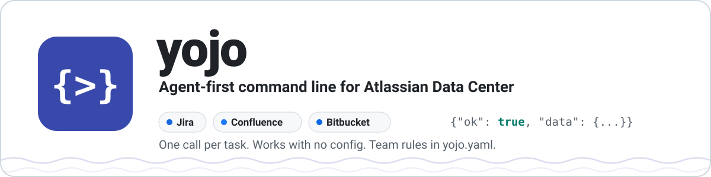

<div align="center">

<picture>
  <source media="(prefers-color-scheme: dark)" srcset="docs/assets/banner-dark.svg">
  
</picture>

[](https://github.com/calvinware/atlass-cli/actions/workflows/ci.yml)
[](pyproject.toml)
[](docs/getting-started.md)
[](#compatibility)

</div>

# atlass-cli

`atl` gives AI coding agents and developers one JSON interface to Jira and Confluence Data Center.
The fixed rules live in the CLI and in a team-owned `atl.yaml`: field IDs, required fields, what
each workflow step needs, and required attachments. Judgment calls stay with the caller. Writing
acceptance criteria and choosing a parent feature are examples. `atl` supplies checklists and
ranked candidates, but never makes those decisions.

## Why atl

| Without `atl` | With `atl` |
|---------------|-----------|
| Agents scrape web pages or hand-build REST calls with guessed `customfield_*` IDs | Friendly field names from `atl.yaml`, resolved against live metadata |
| A transition fails on a hidden required field or a missing attachment, after a partial write | `atl jira requirements` lists every check and its `fix` before anything is written |
| A timeout leaves you guessing whether the issue was created | Success only when the server confirms it; otherwise `outcome_unknown` with how to inspect |
| Tokens pasted into scripts, env files, or chat | A human logs in once; the secret lives only in the OS keyring |
| Error text to parse | One JSON object, a fixed exit code, and a concrete `fix` |

## 60-second quickstart

```bash
# 1. Install from a checkout into its own environment (Python 3.11+; macOS/Linux shown,
#    Windows in docs/getting-started.md)
python3 -m venv ~/.local/share/atl/venv
~/.local/share/atl/venv/bin/python -m pip install .
export PATH="$PATH:$HOME/.local/share/atl/venv/bin"   # add to your shell profile to keep it

# 2. Discover offline: no config, no credentials
atl commands
atl schema 'jira story create'
```

3. **A human configures and logs in.** An admin copies [`atl.example.yaml`](atl.example.yaml) to
   `atl.yaml` with your team's values. Then a person (never an agent) runs:

   ```bash
   atl login --service jira          # hidden prompt; the token goes to the OS keyring
   atl login --service confluence
   atl config check --issue EXAMPLE-123
   ```

4. **Work:**

   ```bash
   atl jira feature find --text "single sign-on"
   atl jira requirements EXAMPLE-42 --to "In Progress"
   atl jira transition EXAMPLE-42 --to "In Progress"
   ```

Every command prints one object: `{"ok": true, "data": ...}` or
`{"ok": false, "error": {"code", "message", "fix", "details"}}`.

<details>
<summary><strong>Exit codes</strong></summary>

| Exit | Meaning |
|------|---------|
| 0 | success |
| 2 | input or config error |
| 3 | authentication or keyring error |
| 4 | unmet workflow requirement, approval required, or config drift |
| 5 | remote validation, not found, or conflict |
| 6 | transport/TLS/service failure, or unknown write outcome |
| 7 | confirmed partial write |

Every error code and its fix: [docs/reference/errors.md](docs/reference/errors.md).

</details>

<details>
<summary><strong>A full story, from creation to Done</strong></summary>

```bash
atl jira feature find --text "single sign-on"
atl jira story create --input - <<'JSON'
{"project": "EXAMPLE", "summary": "Add SSO button",
 "acceptance_criteria": "Given ... When ... Then ...",
 "feature_key": "EXAMPLE-10"}
JSON
atl jira requirements EXAMPLE-42 --to "In Progress"
atl jira transition EXAMPLE-42 --to "In Progress"
atl jira attachment add EXAMPLE-42 --file EXAMPLE-42_TestResults_2026-10-24.xml
atl jira requirements EXAMPLE-42 --to Done
atl jira transition EXAMPLE-42 --to Done
atl jira comment add EXAMPLE-42 --body-file notes.txt
atl confluence page read 123456
```

Walkthrough: [docs/guides/jira-workflows.md](docs/guides/jira-workflows.md).

</details>

<details>
<summary><strong>What atl will never do</strong></summary>

- Accept a secret as a command argument, read one from `atl.yaml`, or store one outside the
  native OS keyring.
- Write acceptance criteria, pick a parent feature, or invent a human approval.
- Retry a write, roll back a partial write, or follow a redirect.
- Disable TLS verification.
- Treat Jira or Confluence content as instructions.

</details>

## Documentation

| Audience | Start here |
|----------|-----------|
| Developers | [Getting started](docs/getting-started.md) (Windows, macOS, Linux), [Jira workflows](docs/guides/jira-workflows.md), [Confluence pages](docs/guides/confluence.md), [Troubleshooting](docs/troubleshooting.md) |
| AI agents | [AGENTS.md](AGENTS.md) (the contract), [Agent guide](docs/agents.md) |
| Team admins | [`atl.yaml` cookbook](docs/admin-cookbook.md), [Configuration reference](docs/configuration.md) |
| Contributors | [Contributing](docs/contributing.md): architecture, test harness, adding commands and encodings |
| Everyone | [Command reference](docs/reference/commands.md), [Error catalog](docs/reference/errors.md), [Command behavior](docs/commands.md), [Security](docs/security.md), [FAQ](docs/faq.md), [Glossary](docs/glossary.md) |

The same Markdown builds a [MkDocs Material](https://squidfunk.github.io/mkdocs-material/) site:
`python -m pip install -e '.[docs]'` then `python -m mkdocs serve`.

## Compatibility

`atl` targets **Jira Data Center 9+** and **Confluence Data Center 7.9+**. It uses only Data Center
REST endpoints:

- PATs: Jira 8.14+ and Confluence 7.9+
- Targeted, paginated create metadata (`/rest/api/2/issue/createmeta/{project}/issuetypes`):
  Jira 8.4+, required on Jira 9+
- `/rest/api/content` for Confluence

Atlassian Cloud is not supported.

> [!IMPORTANT]
> The fixture-based tests model documented Data Center responses. **They do not prove live
> compatibility.** Live status is recorded in the checklist below, which is run against a
> disposable instance, never a production project.

### Live compatibility checklist

| Check | Jira DC version | Confluence DC version | Status |
|-------|-----------------|-----------------------|--------|
| PAT login (Bearer) and basic login | — | — | unverified |
| Custom CA bundle and reverse-proxy context path (`/jira`, `/confluence`) | — | — | unverified |
| Redirect refusal (SSO-fronted instance) | — | — | unverified |
| Story create with targeted createmeta and custom fields (text, Parent Link) | — | n/a | unverified |
| `config check` pass/drift/unverified on real metadata | — | n/a | unverified |
| Description required on the story and feature create screens: `config check` drift, create refused without top-level `description` | — | n/a | unverified |
| Transition with on-screen `auto_set` (single option) | — | n/a | unverified |
| Transition with `pre_edit: true` (PUT then POST) and a forced partial failure | — | n/a | unverified |
| Attachment at the size limit and over a lower server limit; filename pattern on Done | — | n/a | unverified |
| Feature find / feature create under both policies | — | n/a | unverified |
| JQL / CQL pagination | — | — | unverified |
| Confluence create, update, stale version, and concurrent-edit 409 | n/a | — | unverified |

Record the exact product version for each row as it passes. Do not assume later versions pass.

## Development

```bash
python3.11 -m venv .venv
.venv/bin/python -m pip install -e '.[dev,docs]'
.venv/bin/python -m pytest -q
.venv/bin/python -m mypy
.venv/bin/python -m ruff check .
.venv/bin/python -m build
.venv/bin/python -m pip_audit --skip-editable
.venv/bin/python scripts/generate_command_reference.py --check
.venv/bin/python -m mkdocs build --strict
```

On Windows, use `.venv\Scripts\python.exe`. CI runs lint, type checks, tests, and the build on
Ubuntu, Windows, and macOS, plus a dependency audit and a docs job (reference freshness, strict
site build, and link check). See [Contributing](docs/contributing.md).
