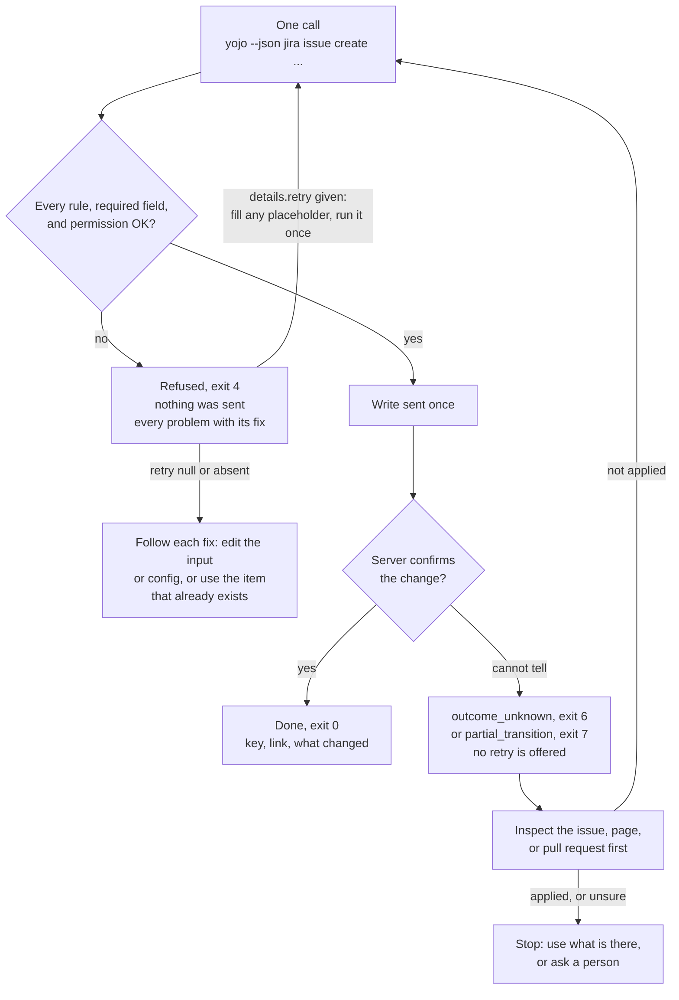
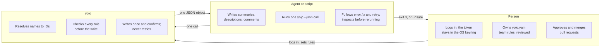
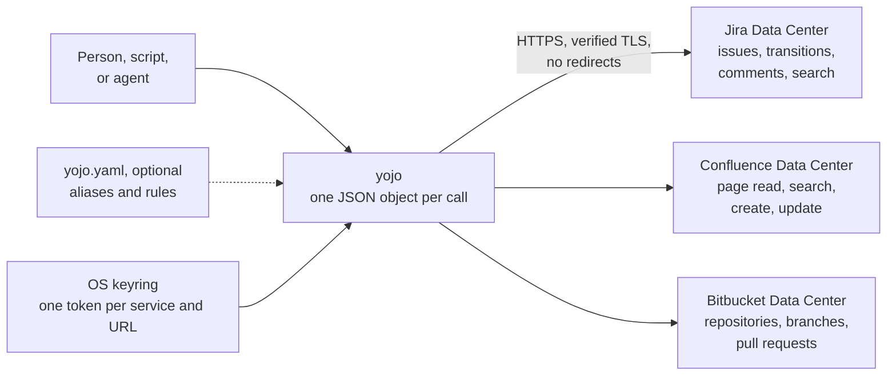

<div align="center">

<picture>
  <source media="(prefers-color-scheme: dark)" srcset="https://raw.githubusercontent.com/calvinware/yojo/e54a1c55d8d93250aa7a8e974c1586e3b1a8a257/docs/assets/banner-dark.svg">
  
</picture>

**One call per task for Jira, Confluence, and Bitbucket Data Center: Jira's own words in, every
rule checked before the write, one JSON object out.**

```bash
pipx install git+https://github.com/calvinware/yojo.git@e54a1c55d8d93250aa7a8e974c1586e3b1a8a257   # pre-release; from 0.1.0: pipx install yojo
```


<sub>Recorded with <a href="https://github.com/calvinware/yojo/blob/main/docs/demos/one-call.tape">a VHS tape</a> against yojo's test fixture server (<code>jira.example.test</code>), not a live instance.</sub>

[](https://github.com/calvinware/yojo/actions/workflows/ci.yml)
[](https://github.com/calvinware/yojo/blob/main/pyproject.toml)
[](https://github.com/calvinware/yojo/blob/main/docs/getting-started.md)

</div>

# yojo

`yojo` accepts the field names, statuses, option labels, and people you see in Jira, resolves the
IDs itself, and checks every rule before it writes. It works with no config file. A `yojo.yaml`
adds your team's friendly names and rules on top.

`yojo` is not on PyPI yet. Until the first release, the install line above builds it from this
repository; afterwards, `pipx install yojo` or `uv tool install yojo` (Python 3.11+). See
[Install](https://github.com/calvinware/yojo/blob/main/docs/getting-started.md#install) for
Windows, macOS, and Linux steps without `pipx`.

## Five minutes: log in, set up, read

1. **Log in** (a person, once per instance). The token goes from a hidden prompt straight to the
   OS keyring:

   ```bash
   yojo login --service jira --base-url https://jira.example.test/jira
   ```

2. **Set up** (optional). In a terminal, `yojo setup` opens a seven-step app: connect, log in,
   choose projects and repositories, map fields and rules, review and save `yojo.yaml`, connect
   your agent, and try a read. Every step has a plain command too; see the
   [setup guide](https://github.com/calvinware/yojo/blob/main/docs/getting-started.md#set-up-in-a-terminal-yojo-setup).

3. **Read** something. No config is needed:

   ```bash
   yojo jira issue get PROJ-123 --base-url https://jira.example.test/jira
   ```

<p align="center">
<picture>
  <source media="(prefers-color-scheme: dark)" srcset="https://raw.githubusercontent.com/calvinware/yojo/e54a1c55d8d93250aa7a8e974c1586e3b1a8a257/docs/assets/setup/step-5-dark.svg">
  
</picture>
<br><sub>Step 5 of <code>yojo setup</code>: review the exact file before anything is written.</sub>
</p>

`yojo commands` and `yojo schema 'jira issue create'` list every command and its exact contract
offline, with no config or credentials.

## Every write: check, fix, write, confirm

A write is one command line. Fields go in by the names Jira shows, in any case:

```bash
yojo --json jira issue create PROJ --type Bug --summary "Fix example sign-in" \
  --set Severity=Major --set "Story Points=3" --base-url https://jira.example.test/jira
```



- **Refused** means nothing was sent. The result lists every problem at once, each with a `fix`.
  When `yojo` can correct the command itself, `details.retry` is your command with the fixes
  applied; a `<placeholder>` marks content only you can supply, and `yojo` never invents a value.
  When `retry` is `null` or absent (a value came from `--input`, the pull request or comment
  already exists, or the config has drifted), follow each `fix` instead.
- **Done** only when the server confirms it. The result names the key, the link, and what
  changed.
- **Unknown** means the write may have happened. `yojo` never retries a write. `error.fix` names
  the commands to inspect remote state; run the write again only if it was not applied.

## Two faces, one result

In a terminal, `yojo` shows aligned tables, plain-language status, and a link after each write.
When stdout is piped, or with `--json`, it prints exactly one compact JSON object:
`{"ok":true,"data":...}` or `{"ok":false,"error":{"code","message","fix","details"}}`. Exit codes
are the same in both modes, and `NO_COLOR` turns color off. The
[command reference](https://github.com/calvinware/yojo/blob/main/docs/reference/commands.md)
shows each command's exact terminal and JSON output, captured from the test fixtures.

Reads stay small: `jira issue get` returns the fields that matter, `--fields "Story Points,description"`
asks for more, long text is trimmed with a `more` command for the rest, and lists return
`next_start` to pass as `--start` for the next page.

## Use it from your agent

`yojo agent install` writes compact instructions where your tool looks for them. They carry every
command's signature and a `--json` example in under 12 KiB, so the agent can act in one call with
no lookup first. Pick your tool:

```bash
yojo --json agent install --target agents    # AGENTS.md, read by many tools
yojo --json agent install --target claude    # .claude/skills/yojo/SKILL.md
yojo --json agent install --target cursor    # .cursor/rules/yojo.mdc
yojo --json agent install --target copilot   # .github/copilot-instructions.md
yojo --json agent install --target gemini    # GEMINI.md
```

Repeat `--target` to install several at once. Only the section between the `yojo:begin` and
`yojo:end` markers belongs to `yojo`; the rest of each file is kept. For any other chat,
`yojo agent print` prints the same text to paste.

The one-call shape an agent follows:

1. Run the task once with `--json`, using natural values.
2. Exit 0: done. Exit 4: nothing was sent; follow each check's `fix`. Only when `details.retry` is
   present, fill each `<placeholder>` with real content and run it once. If it is `null`, edit
   the input or use the item that already exists, as the `fix` says.
3. Exit 3: ask the person to run `yojo login`. Exit 6 `outcome_unknown` or exit 7: inspect with
   the commands in `error.fix` before anything else.

Who decides what:



The full contract, including the safety rules, is in
[AGENTS.md](https://github.com/calvinware/yojo/blob/main/AGENTS.md) and the
[agent guide](https://github.com/calvinware/yojo/blob/main/docs/agents.md).

## Jira, Confluence, and Bitbucket



Opening a pull request is one call too, after a person logs in to Bitbucket once with
`yojo login --service bitbucket --base-url https://bitbucket.example.test/bitbucket`. Both
branches are checked, and an open pull request for the same branches is refused:

```bash
yojo --json bitbucket pr create --repo PROJ/web --source feature/sign-in --target main \
  --title "Fix example sign-in" --base-url https://bitbucket.example.test/bitbucket
```

Agents may list, read, diff, create, and comment on pull requests. Approving and merging are for
people; there is no command for them.

## Coming from `atl`

`yojo` replaces the `atl` command. It does not read an old `atl.yaml`: when it finds one without
a `yojo.yaml`, it stops with `config_legacy`, changes nothing, and says what to rename and remove.
See [Moving from `atl.yaml`](https://github.com/calvinware/yojo/blob/main/docs/configuration.md#moving-from-atlyaml)
and the [changelog](https://github.com/calvinware/yojo/blob/main/CHANGELOG.md) for every breaking
change. Run `yojo login` again; old logins are not reused.

## Documentation

| Audience | Start here |
|----------|------------|
| Developers | [Getting started](https://github.com/calvinware/yojo/blob/main/docs/getting-started.md), [Jira workflows](https://github.com/calvinware/yojo/blob/main/docs/guides/jira-workflows.md), [Confluence pages](https://github.com/calvinware/yojo/blob/main/docs/guides/confluence.md), [Bitbucket pull requests](https://github.com/calvinware/yojo/blob/main/docs/guides/bitbucket.md) |
| AI agents | [AGENTS.md](https://github.com/calvinware/yojo/blob/main/AGENTS.md), [Agent guide](https://github.com/calvinware/yojo/blob/main/docs/agents.md) |
| Admins | [Configuration](https://github.com/calvinware/yojo/blob/main/docs/configuration.md), [Cookbook](https://github.com/calvinware/yojo/blob/main/docs/admin-cookbook.md) |
| Contributors | [Contributing](https://github.com/calvinware/yojo/blob/main/docs/contributing.md), [Security](https://github.com/calvinware/yojo/blob/main/docs/security.md), [0.1.0 release notes (draft)](https://github.com/calvinware/yojo/blob/main/docs/release-notes-0.1.0.md) |
| Everyone | [Command reference](https://github.com/calvinware/yojo/blob/main/docs/reference/commands.md), [Error catalog](https://github.com/calvinware/yojo/blob/main/docs/reference/errors.md), [FAQ](https://github.com/calvinware/yojo/blob/main/docs/faq.md), [Troubleshooting](https://github.com/calvinware/yojo/blob/main/docs/troubleshooting.md) |

## Compatibility

`yojo` targets Jira Data Center 9+, Confluence Data Center 7.9+, and Bitbucket Data Center (REST
1.0) on Windows, macOS, and Linux. Atlassian Cloud is not supported for any of the three.
Its fixture tests do not establish live compatibility with every server version. The
[security guide](https://github.com/calvinware/yojo/blob/main/docs/security.md) describes TLS,
keyring, permissions, and uncertain-write handling.

### Live compatibility checklist

Record the exact server version when each path is checked against a disposable instance.
The fixture suite does not substitute for that check.

| Check | Jira version | Confluence version | Status |
|-------|--------------|--------------------|--------|
| PAT and basic login | — | — | unverified |
| Custom CA, context path, and redirect refusal | — | — | unverified |
| Issue create with live fields and required values | — | n/a | unverified |
| Issue update, link, and read-back confirmation | — | n/a | unverified |
| Transition with on-screen and `pre_edit` fields | — | n/a | unverified |
| Attachment permissions and size limits | — | n/a | unverified |
| JQL and CQL pagination | — | — | unverified |
| Confluence create, update, and stale-version conflict | n/a | — | unverified |

| Bitbucket check | Bitbucket version | Status |
|-----------------|-------------------|--------|
| Token login (application identity and signed-in check) | — | unverified |
| Repository, branch, and pull request list cursors | — | unverified |
| Pull request diff, including server-side truncation | — | unverified |
| Pull request create and comment, including duplicate refusal | — | unverified |
