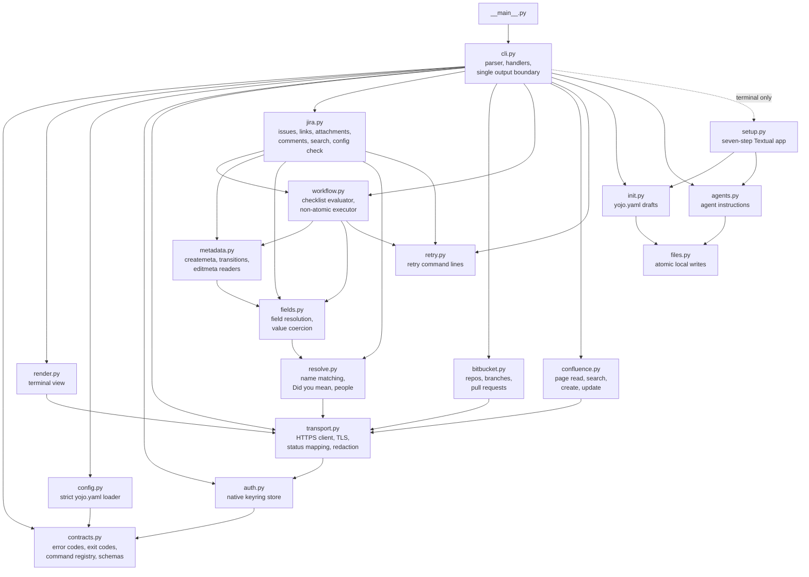

# Contributing

This page is for people changing `yojo` itself: the architecture, the test harness, and the
checklists for adding a command, an error code, or a field type.

## Development setup

```bash
python3.11 -m venv .venv
.venv/bin/python -m pip install -e '.[dev,docs]'
.venv/bin/python -m ruff check .
.venv/bin/python -m mypy
.venv/bin/python -m pytest -q
.venv/bin/python -m build
.venv/bin/python -m twine check --strict dist/*
.venv/bin/python scripts/generate_command_reference.py --check
.venv/bin/python scripts/capture_setup.py --check
.venv/bin/python -m mkdocs build --strict
```

On Windows, use `.venv\Scripts\python.exe`. CI runs lint, type checks, tests, and the build on
Ubuntu, Windows, and macOS with Python 3.11, 3.13, 3.14, and 3.15. The Python 3.15 setup step
permits prereleases when a final release is unavailable. The dependency audit and the docs job run
on Ubuntu with Python 3.11, 3.14, and 3.15. Python 3.12 is supported by the 3.11 floor but is not
a CI matrix entry.
Keep code compatible with 3.11: mypy checks `python_version = "3.11"` and Ruff targets `py311`.

## Architecture

Everything enters through `cli.main`. In JSON mode it prints exactly one compact JSON envelope; on
a terminal, `render.render` prints the friendly view of that same envelope. Domain modules raise
`YojoError` with a registered code, and `cli.main` turns it into the error envelope and exit code.



| Module | Responsibility |
|--------|----------------|
| [`contracts.py`](../src/yojo/contracts.py) | `ERROR_CODES`, `EXIT_CODES_DOC`, `YojoError`, the `COMMANDS` registry of `CommandSpec`, and every JSON Schema. The source of truth for `yojo commands` and `yojo schema`. |
| [`cli.py`](../src/yojo/cli.py) | argparse parser (JSON usage errors), `--set` parsing, input reading and schema validation, `HANDLERS`, and `main`. |
| [`render.py`](../src/yojo/render.py) | The terminal view of an envelope: tables, status colors (off with `NO_COLOR` or `TERM=dumb`), and control-character cleanup. Never used in JSON mode. |
| [`config.py`](../src/yojo/config.py) | `yojo.yaml` discovery, the legacy `atl.yaml` refusal, the safe loader, and strict validation into typed config objects. |
| [`auth.py`](../src/yojo/auth.py) | Credentials in the native OS keyring only. |
| [`transport.py`](../src/yojo/transport.py) | `ServiceClient`: verified TLS, no redirects, size caps, HTTP status to error code mapping, write outcome tracking, sanitizing and redaction. |
| [`metadata.py`](../src/yojo/metadata.py) | Fail-closed readers for Jira create, transition, and edit metadata, plus the server version, project list, and project statuses used by `yojo setup`. |
| [`resolve.py`](../src/yojo/resolve.py) | Case-insensitive matching of names and labels, ambiguity with candidates, "Did you mean ...?" suggestions, and people lookup. |
| [`fields.py`](../src/yojo/fields.py) | Resolves field names, aliases, and IDs to live fields, and coerces plain values to the field's live type. |
| [`retry.py`](../src/yojo/retry.py) | Builds the corrected `retry` command line from the caller's argv and each check's edit. |
| [`workflow.py`](../src/yojo/workflow.py) | Pure transition checklist plus the PUT/recheck/POST executor. |
| [`init.py`](../src/yojo/init.py) | `yojo init`: the draft from named URLs, projects, and `--input` policy, live checks, and guarded saves. `build` returns an immutable `Candidate`; `publish_reviewed` writes exactly its bytes after re-checking the file and live metadata. |
| [`setup.py`](../src/yojo/setup.py), [`setup.tcss`](../src/yojo/setup.tcss) | The `yojo setup` Textual app. `cli.py` imports it only when stdout and stdin are terminals and `--json` is absent. Its `Services` class is the app's only door to the network, keyring, and files, and reuses `verify_and_store`, `init.build`/`init.publish_reviewed`, `agents.install`, and `cli.outcome`. |
| [`agents.py`](../src/yojo/agents.py) | The agent instruction core generated from `COMMANDS`, target wrappers, and marked-section installs. |
| [`files.py`](../src/yojo/files.py) | Conflict-checked atomic writes of local files: same-folder temp file, hard-link create, compare-then-replace, no symbolic links. |
| [`response.py`](../src/yojo/response.py) | Output budgets: long text is trimmed with a marker and a `more` command. |
| [`jira.py`](../src/yojo/jira.py), [`confluence.py`](../src/yojo/confluence.py), [`bitbucket.py`](../src/yojo/bitbucket.py) | Command implementations. |

## Test harness

Tests never touch a real server or keyring. [`tests/conftest.py`](../tests/conftest.py) provides a
`harness` fixture:

- `FakeServer` serves canned responses through an `httpx` mock transport and records every
  request, so a test can assert that nothing was written.
- `FakeKeyring` stands in for the OS keyring.
- `harness.run(*argv, stdin=..., tty=..., hidden=[...])` calls `cli.main` with an injected
  `Runtime` in JSON mode. It asserts exactly one compact JSON line on stdout with no ANSI codes,
  and validates the envelope against the command's published success or error schema.
- `harness.run_tty(*argv, environ=...)` runs with stdout on a terminal and returns the rendered
  text, so a test can check the friendly view of the same envelope.
- JSON fixtures in [`tests/fixtures/`](../tests/fixtures/) model documented Data Center responses.
- [`tests/test_setup.py`](../tests/test_setup.py) drives the setup app with Textual's pilot
  against `FakeServer` routes from [`tests/setup_support.py`](../tests/setup_support.py).
  [`tests/test_setup_cli.py`](../tests/test_setup_cli.py) checks when the app may open, including
  real pseudo-terminal runs on macOS and Linux.
- `python scripts/capture_setup.py --write` regenerates the light and dark SVG captures of each
  setup step in `docs/assets/setup/` from the same fixtures; `--check` fails when they drift.
  CI runs `--check` on Ubuntu with Python 3.14 and the Textual and Rich versions pinned in
  `.github/workflows/ci.yml`; regenerate with those versions. Review the images after any change
  to the app's layout or text.

> [!NOTE]
> Fixture tests prove behavior against modeled responses, not live compatibility. Live results go
> in the README checklist after a run against a disposable instance.

## Add a command

1. **Contract.** Add a `CommandSpec` to `COMMANDS` in `contracts.py`: `path`, `summary`, `usage`,
   one `example`, `arguments`, `success`, optional `input`, and the `errors` it can raise. Keep the
   schema small enough to paste into a prompt.
2. **Parser.** Add the leaf in `cli.build_parser` with the same path. Argument `dest` names must
   match the schema's `arguments` properties. Reuse existing flags with the same meaning
   (`--input -`, `--to`, `--set`, `--fields`).
3. **Handler.** Write `cmd_<name>` in `cli.py` and register it in `HANDLERS`. Domain logic goes in
   the service module; raise `YojoError` with registered codes only.
4. **Values.** Accept names as Jira shows them, in any case, and resolve IDs inside the command
   with `resolve.py` and `fields.py`. Never make the caller look up an ID.
5. **Writes.** Check every rule and required field first, and refuse with
   `requirements_unmet` listing every problem, each with a `fix`, plus the corrected `retry` line.
   Never retry. Confirm success from the response or a read-back, and map unconfirmed success to
   `outcome_unknown` with a command-specific inspection `fix`.
6. **Terminal view.** Check the `run_tty` output: it names the thing changed and links to it.
7. **Tests.** `tests/test_cli.py` already fails if the registry, parser, and handlers disagree.
   Add behavior tests with the harness, including a "nothing was written" assertion for refused
   writes. `tests/test_one_call.py` runs every command's registry `example` once, exactly as
   written; add the command's fixture routes to `GOLDEN_SETUP`. The example and usage line are
   what `yojo agent install` writes, so `tests/test_agents.py` checks that the usage names every
   parser flag and that the installed text stays within 12 KiB.
8. **Docs.** Add an entry to [`docs/examples/commands.json`](examples/commands.json), then run
   `python scripts/generate_command_reference.py --write`. The generator refuses to run until every
   discovered command has a schema-valid example, and CI fails while the committed reference is
   stale. Update the task guides if the command changes a workflow.

## Add an error code

Add it to `ERROR_CODES` with its exit code, list it in the `errors` of each command that can raise
it, and add an entry to [`docs/examples/error-fixes.json`](examples/error-fixes.json). Regenerate
the reference; the generator requires exactly one catalog entry per registered code. Every `fix`
must be a runnable command or an exact edit (file, key, value).

## Support a new field type

1. Teach `fields.coerce` to turn a plain value into the payload for the live schema type, and
   `fields.confirmed` to compare the read-back value. Fail with a `FieldProblem` and a concrete
   fix when the schema or allowed values cannot confirm a safe value.
2. Test the coercion, the refusal, and the read-back in `tests/test_jira.py`.
3. Add the type to the values tables in [configuration](configuration.md#fields-and-aliases) and
   the [cookbook](admin-cookbook.md#values).

## Documentation

- Write shared pages in `docs/` as GitHub-flavored Markdown. They must read well on GitHub and
  build with MkDocs Material.
- Use GitHub alerts (`> [!NOTE]`, `> [!TIP]`, `> [!IMPORTANT]`, `> [!WARNING]`), never `!!!`
  admonitions. The site converts alerts.
- Use `mermaid` fences for diagrams.
- Per-OS steps use ordinary `### Windows`, `### macOS`, `### Linux` headings between
  `<!-- os-tabs:start -->` and `<!-- os-tabs:end -->`. The site renders them as tabs.
- Link to files outside `docs/` with relative paths (`../AGENTS.md`). The site rewrites them to
  GitHub source links.
- Never edit `docs/reference/*.md` by hand. Change the registry or `docs/examples/`, then
  regenerate.
- Examples use `EXAMPLE-*` or `PROJ-*` keys and `*.example.test` hosts, never real tenant data or
  secrets.
- Set `YOJO_REQUIRE_SITE_BUILD=1` to make the docs tests fail, instead of skip, when MkDocs is not
  installed. The CI docs job sets it.

Before opening a pull request:

```bash
python scripts/generate_command_reference.py --check
python -m mkdocs build --strict
lychee --config lychee.toml README.md AGENTS.md 'docs/**/*.md'
```

## Release

Releases go to [PyPI](https://pypi.org/project/yojo/) as `yojo` through
[`.github/workflows/release.yml`](../.github/workflows/release.yml) with
[Trusted Publishing](https://docs.pypi.org/trusted-publishers/): GitHub Actions proves its
identity to PyPI over OIDC, so there is no API token anywhere. Pushing a `v*` tag starts the
workflow. Its `verify` job runs [`scripts/release_gate.py`](../scripts/release_gate.py) and fails
unless all of these hold:

- the tag is exactly `v` plus `project.version` from `pyproject.toml`;
- the tagged commit is on the first-parent history of `main`;
- the `CI` workflow's push run on `main` for that exact commit concluded `success`.

Only then does the `build` job run the tests, build the wheel and sdist, and run
`twine check --strict` and `scripts/check_package.py`, which also checks that the files are the
`yojo` distribution at `project.version`, ship the `yojo` package and the `yojo` command, and
contain nothing from the old `atlass_cli` package or `atl` command. Its `publish` job uploads
those files. PR
CI runs `actionlint` and `tests/test_release.py`, which check these release workflow invariants
and the gate's failure cases.
First-parent membership does not prove the commit was reviewed; enforce pull-request reviews on
`main` in the repository settings before creating a release tag.

> [!WARNING]
> A pushed tag is a public, irreversible release. PyPI never accepts the same version twice, even
> after a delete. Push a tag only after every step before it is done.

One-time setup, done by a repository owner before the first release:

1. Confirm the repository is public, so the README's absolute file and banner URLs resolve on
   PyPI and pass the `docs` job's link check, and that job passes on `main` before tagging.
2. Protect `main` with required pull-request reviews and the `CI` check. Confirm those rules are
   active before tagging; the release script cannot attest a human review from Git history alone.
3. In the repository settings, create a GitHub Actions environment named `pypi` and add required
   reviewers to it, so each publish waits for a human approval.
4. Add a tag ruleset that targets `v*` and restricts creation, update, and deletion to release
   owners, so nobody else can start or move a release.
5. On PyPI, add a pending publisher (*Your account > Publishing > Add a new pending publisher >
   GitHub*) with these exact values:

   | Field | Value |
   |-------|-------|
   | PyPI project name | `yojo` |
   | Owner | `calvinware` |
   | Repository name | `yojo` |
   | Workflow name | `release.yml` |
   | Environment name | `pypi` |

   The first successful publish creates the project and turns the pending publisher into a normal
   one. The earlier `atlass-cli` project on PyPI stays as it is; do not publish to it.

Each release:

1. Get the owner's go-ahead; never tag or publish without it. Then set `version` in
   `pyproject.toml` to the new `X.Y.Z` in a pull request, add the changelog entry (breaking changes
   are allowed below 1.0 but are always listed), wait for CI to pass, get it reviewed, and merge
   it. The first release needs no bump: `pyproject.toml` already says `0.1.0`, so tag `v0.1.0` on
   the reviewed merge commit that contains it.
2. Find that exact merge commit on `main`, confirm the `CI` workflow passed for it, and tag that
   commit explicitly rather than whatever `main` points to now:

   ```bash
   git fetch origin main
   git log --first-parent --oneline origin/main   # pick the reviewed merge commit's SHA
   git tag -a vX.Y.Z -m "yojo X.Y.Z" <merge-commit-sha>
   git push origin vX.Y.Z
   ```

3. Watch the `Release` workflow in GitHub Actions. If `verify` fails, read its errors; do not move
   or re-push the tag. Approve the `pypi` environment when it asks.
4. On PyPI, check that the release has one wheel and one sdist and that the project page shows the
   README, the MIT license, and the project links.
5. In a clean shell, run `pipx install yojo` (or `uv tool install yojo`), then `yojo --version`,
   `yojo commands`, and `yojo schema 'jira issue create'`.
6. After the first release only, once step 5 works: in a pull request, change the install section
   of `docs/getting-started.md` to say the package is available on PyPI, and recheck that the
   README's package-first install steps work as written.
