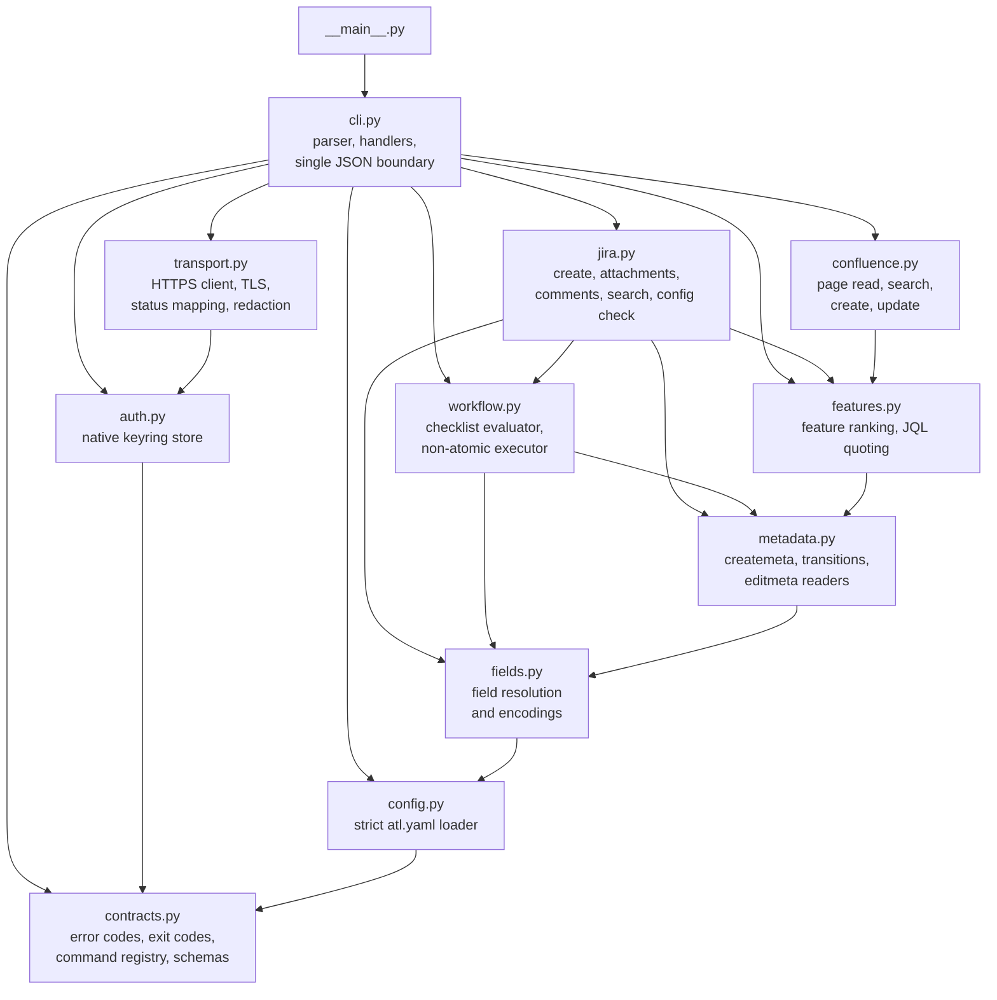

# Contributing

This page is for people changing `atl` itself: the architecture, the test harness, and the
checklists for adding a command or a field encoding.

## Development setup

```bash
python3.11 -m venv .venv
.venv/bin/python -m pip install -e '.[dev,docs]'
.venv/bin/python -m ruff check .
.venv/bin/python -m mypy
.venv/bin/python -m pytest -q
.venv/bin/python -m build
.venv/bin/python -m twine check --strict dist/*
.venv/bin/python scripts/generate_command_reference.py --check
.venv/bin/python -m mkdocs build --strict
```

On Windows, use `.venv\Scripts\python.exe`. CI runs lint, type checks, tests, and the build on
Ubuntu, Windows, and macOS with Python 3.11, 3.13, 3.14, and 3.15. The Python 3.15 setup step
permits prereleases when a final release is unavailable. The dependency audit and the docs job run
on Ubuntu with Python 3.11, 3.14, and 3.15. Python 3.12 is supported by the 3.11 floor but is not
a CI matrix entry.
Keep code compatible with 3.11: mypy checks `python_version = "3.11"` and Ruff targets `py311`.

## Architecture

Everything enters through `cli.main`, which prints exactly one JSON envelope. Domain modules raise
`AtlError` with a registered code, and `cli.main` turns it into the error envelope and exit code.



| Module | Responsibility |
|--------|----------------|
| [`contracts.py`](../src/atlass_cli/contracts.py) | `ERROR_CODES`, `EXIT_CODES_DOC`, `AtlError`, the `COMMANDS` registry of `CommandSpec`, and every JSON Schema. The source of truth for `atl commands` and `atl schema`. |
| [`cli.py`](../src/atlass_cli/cli.py) | argparse parser (JSON usage errors), input reading and schema validation, `HANDLERS`, and `main`. |
| [`config.py`](../src/atlass_cli/config.py) | `atl.yaml` discovery, the safe loader, and strict validation into typed config objects. |
| [`auth.py`](../src/atlass_cli/auth.py) | Credentials in the native OS keyring only. |
| [`transport.py`](../src/atlass_cli/transport.py) | `ServiceClient`: verified TLS, no redirects, size caps, HTTP status to error code mapping, write outcome tracking, sanitizing and redaction. |
| [`metadata.py`](../src/atlass_cli/metadata.py) | Fail-closed readers for Jira create, transition, and edit metadata. |
| [`fields.py`](../src/atlass_cli/fields.py) | Resolves friendly names to live fields and serializes values per encoding. |
| [`workflow.py`](../src/atlass_cli/workflow.py) | Pure transition checklist plus the PUT/recheck/POST executor. |
| [`jira.py`](../src/atlass_cli/jira.py), [`features.py`](../src/atlass_cli/features.py), [`confluence.py`](../src/atlass_cli/confluence.py) | Command implementations. |

## Test harness

Tests never touch a real server or keyring. [`tests/conftest.py`](../tests/conftest.py) provides a
`harness` fixture:

- `FakeServer` serves canned responses through an `httpx` mock transport and records every
  request, so a test can assert that nothing was written.
- `FakeKeyring` stands in for the OS keyring.
- `harness.run(*argv, stdin=..., tty=..., hidden=[...])` calls `cli.main` with an injected
  `Runtime`, asserts exactly one JSON line on stdout, and validates the envelope against the
  command's published success or error schema.
- JSON fixtures in [`tests/fixtures/`](../tests/fixtures/) model documented Data Center responses.

> [!NOTE]
> Fixture tests prove behavior against modeled responses, not live compatibility. Live results go
> in the README checklist after a run against a disposable instance.

## Add a command

1. **Contract.** Add a `CommandSpec` to `COMMANDS` in `contracts.py`: `path`, `summary`,
   `arguments`, `success`, optional `input`, the `errors` it can raise, and `needs_config`.
2. **Parser.** Add the leaf in `cli.build_parser` with the same path. Argument `dest` names must
   match the schema's `arguments` properties.
3. **Handler.** Write `cmd_<name>` in `cli.py` and register it in `HANDLERS`. Domain logic goes in
   the service module; raise `AtlError` with registered codes only.
4. **Writes.** Never retry. Confirm success from the response, and map unconfirmed success to
   `outcome_unknown` with a command-specific inspection `fix`.
5. **Tests.** `tests/test_cli.py` already fails if the registry, parser, and handlers disagree.
   Add behavior tests with the harness, including a "nothing was written" assertion for refused
   writes.
6. **Docs.** Add an entry to [`docs/examples/commands.json`](examples/commands.json), then run
   `python scripts/generate_command_reference.py --write`. The generator refuses to run until every
   discovered command has a schema-valid example, and CI fails while the committed reference is
   stale. Update the task guides if the command changes a workflow.

## Add an error code

Add it to `ERROR_CODES` with its exit code, list it in the `errors` of each command that can raise
it, and add an entry to [`docs/examples/error-fixes.json`](examples/error-fixes.json). Regenerate
the reference; the generator requires exactly one catalog entry per registered code.

## Add a field encoding

1. Add the name to `ENCODINGS` in `config.py`.
2. Teach `fields.serialize` to validate the live schema and allowed values and build the payload.
   Fail with a `FieldProblem` and a concrete fix when the schema cannot confirm a safe value.
3. Add the schema compatibility rule to `_ENCODING_SCHEMAS` in `jira.py` so `atl config check`
   reports drift.
4. Test config validation, serialization, and the drift check (`tests/test_config.py`,
   `tests/test_jira.py`).
5. Document it in the encoding tables in [configuration](configuration.md#fields-and-encodings) and
   the [cookbook](admin-cookbook.md#encodings).

## Documentation

- Write shared pages in `docs/` as GitHub-flavored Markdown. They must read well on GitHub and
  build with MkDocs Material.
- Use GitHub alerts (`> [!NOTE]`, `> [!TIP]`, `> [!IMPORTANT]`, `> [!WARNING]`), never `!!!`
  admonitions. The site converts alerts.
- Use `mermaid` fences for diagrams.
- Per-OS steps use ordinary `### Windows`, `### macOS`, `### Linux` headings between
  `<!-- os-tabs:start -->` and `<!-- os-tabs:end -->`. The site renders them as tabs.
- Link to files outside `docs/` with relative paths (`../AGENTS.md`). The site rewrites them to
  GitHub source links.
- Never edit `docs/reference/*.md` by hand. Change the registry or `docs/examples/`, then
  regenerate.
- Examples use `EXAMPLE-*` keys and `*.example.test` hosts, never real tenant data or secrets.

Before opening a pull request:

```bash
python scripts/generate_command_reference.py --check
python -m mkdocs build --strict
lychee --config lychee.toml README.md AGENTS.md 'docs/**/*.md'
```

## Release

Releases go to [PyPI](https://pypi.org/project/atlass-cli/) through
[`.github/workflows/release.yml`](../.github/workflows/release.yml) with
[Trusted Publishing](https://docs.pypi.org/trusted-publishers/): GitHub Actions proves its
identity to PyPI over OIDC, so there is no API token anywhere. Pushing a `v*` tag starts the
workflow. Its `build` job fails unless the tag is exactly `v` plus `project.version` from
`pyproject.toml`, then runs the tests, builds the wheel and sdist, and runs
`twine check --strict`. Its `publish` job uploads those files.

> [!WARNING]
> A pushed tag is a public, irreversible release. PyPI never accepts the same version twice, even
> after a delete. Push a tag only after every step before it is done.

One-time setup, done by a repository owner before the first release:

1. Make the GitHub repository public. Then, in a pull request, delete the two temporary
   private-repository exclusions from `lychee.toml` and confirm the link check passes.
2. In the repository settings, create a GitHub Actions environment named `pypi`. Adding required
   reviewers to it makes each publish wait for an approval.
3. On PyPI, add a pending publisher (*Your account > Publishing > Add a new pending publisher >
   GitHub*) with these exact values:

   | Field | Value |
   |-------|-------|
   | PyPI project name | `atlass-cli` |
   | Owner | `calvinware` |
   | Repository name | `atlass-cli` |
   | Workflow name | `release.yml` |
   | Environment name | `pypi` |

   The first successful publish creates the project and turns the pending publisher into a normal
   one.

Each release:

1. Set `version` in `pyproject.toml` to the new `X.Y.Z` in a pull request. Wait for CI to pass,
   get it reviewed, and merge it.
2. Tag the merged commit on `main` and push only that tag:

   ```bash
   git switch main
   git pull --ff-only
   git tag -a vX.Y.Z -m "atlass-cli X.Y.Z"
   git push origin vX.Y.Z
   ```

3. Watch the `Release` workflow in GitHub Actions. Approve the `pypi` environment if it asks.
4. On PyPI, check that the release has one wheel and one sdist and that the project page shows the
   README, the MIT license, and the project links.
5. In a clean shell, run `pipx install atlass-cli` (or `uv tool install atlass-cli`), then
   `atl commands` and `atl schema 'jira story create'`.
