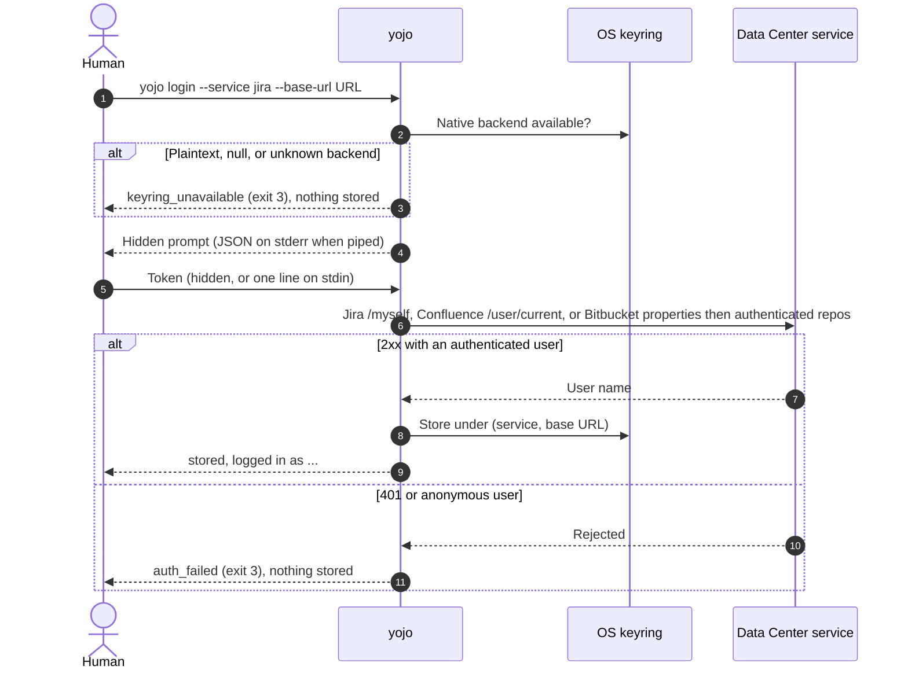

# Getting started

This page takes you from a fresh machine to a working `yojo` setup on Windows, macOS, or Linux.
You need Python 3.11 or later, network access to your Jira, Confluence, or Bitbucket Data Center
servers, and a native OS keyring. CI tests Python 3.11, 3.13, 3.14, and 3.15 on all three systems; 3.12
is not a CI matrix entry.

> [!IMPORTANT]
> A **human** runs `yojo login`. The secret goes from a hidden prompt (or stdin) straight into the
> OS keyring. Never put a token or password in a command argument, a file, an environment
> variable an agent can read, or a chat with an AI tool.

## Install

`yojo` is being prepared for its first PyPI release as `yojo`. Until that release is on
[PyPI](https://pypi.org/project/yojo/), the commands below cannot find the package; install
[from source](#from-source-contributors) instead. Once it is published, install it with either one
of these commands. Each gives `yojo` an isolated environment, links the command into a user `bin`
folder, and works the same on Windows, macOS, and Linux:

```bash
pipx install yojo
# or
uv tool install yojo
```

[`pipx`](https://pipx.pypa.io/) and [`uv`](https://docs.astral.sh/uv/) must already be installed
to use them. If `yojo` is not found afterwards, that folder is not on your `PATH` yet: run
`pipx ensurepath` or `uv tool update-shell`, then open a new terminal and run `yojo commands`.

Without `pipx` or `uv`, install into a virtual environment with `pip`. You need only Python 3.11
or later:

<!-- os-tabs:start -->

### Windows

Install Python 3.11+ from python.org or the Microsoft Store, then in PowerShell:

```powershell
py -3 --version                     # must be 3.11 or later
py -3 -m venv "$env:LOCALAPPDATA\yojo\venv"
& "$env:LOCALAPPDATA\yojo\venv\Scripts\python.exe" -m pip install yojo
& "$env:LOCALAPPDATA\yojo\venv\Scripts\yojo.exe" commands
```

`py -3` runs the newest Python 3 you have installed. If it is older than 3.11, name a newer one
instead, for example `py -3.13`. If you have no `py` launcher (common with the Microsoft Store
build), use `python` in its place.

To run `yojo` by name, append the environment's `Scripts` folder to your user `PATH`, then open a
new terminal:

```powershell
$scripts = "$env:LOCALAPPDATA\yojo\venv\Scripts"
$userPath = [Environment]::GetEnvironmentVariable("Path", "User")
[Environment]::SetEnvironmentVariable("Path", "$userPath;$scripts", "User")
```

### macOS

Install Python 3.11+ (for example `brew install python@3.13`, pyenv, or python.org), then:

```bash
python3 --version                   # must be 3.11 or later
python3 -m venv ~/.local/share/yojo/venv
~/.local/share/yojo/venv/bin/python -m pip install yojo
~/.local/share/yojo/venv/bin/yojo commands
```

If `python3 --version` is older than 3.11, use the newer interpreter by name, for example
`python3.13 -m venv ...`.

To run `yojo` by name, append the environment's `bin` folder to `PATH` in `~/.zshrc` (the default
shell), then open a new terminal:

```bash
echo 'export PATH="$PATH:$HOME/.local/share/yojo/venv/bin"' >> ~/.zshrc
```

### Linux

Install Python 3.11+ from your distribution or pyenv, then:

```bash
python3 --version                   # must be 3.11 or later
python3 -m venv ~/.local/share/yojo/venv
~/.local/share/yojo/venv/bin/python -m pip install yojo
~/.local/share/yojo/venv/bin/yojo commands
```

If `python3 --version` is older than 3.11, use the newer interpreter by name, for example
`python3.11 -m venv ...`. On Debian and Ubuntu, if `venv` reports that `ensurepip` is not
available, install the matching package first (for example `sudo apt install python3.11-venv`).

To run `yojo` by name, append the environment's `bin` folder to `PATH` in your shell profile
(`~/.bashrc` for bash), then open a new terminal:

```bash
echo 'export PATH="$PATH:$HOME/.local/share/yojo/venv/bin"' >> ~/.bashrc
```

<!-- os-tabs:end -->

The `PATH` entry goes last, so the environment's own `python` never shadows the one you already
use.

`yojo commands` works offline with no config. In a terminal it lists every command with an
example; piped (or with `--json`) it prints one JSON object. If you see the list, or
`{"ok":true,...}`, the install works.

### From source (contributors)

To run unreleased changes, install from a checkout instead of PyPI. Clone the repository and
replace `yojo` with `.` in any of the install commands above, for example:

```bash
git clone https://github.com/calvinware/yojo.git
cd yojo
pipx install .
```

For an editable development environment with the test and docs tools, see
[Contributing](contributing.md#development-setup).

## Keyring prerequisites

`yojo` stores credentials only in a native OS keyring. It refuses plaintext, null, and unknown
keyring backends, and it never falls back to a file. If no native keyring is usable, every
command that needs a credential fails with
[`keyring_unavailable`](reference/errors.md#keyring_unavailable) (exit 3).

<!-- os-tabs:start -->

### Windows

**Windows Credential Manager** is built in. Nothing to install. Entries are stored per Windows
user under the service name `yojo`. You can see them in *Control Panel > Credential Manager >
Windows Credentials*.

### macOS

**macOS Keychain** is built in. The login keychain must be unlocked, which it is in a normal
desktop session. The first time `yojo` reads its entry, macOS may ask whether Python may use the
keychain item; choose *Always Allow* for the interpreter that runs `yojo`.

Over SSH the login keychain is usually locked. Unlock it first, or run `yojo` from a desktop
session.

### Linux

`yojo` uses the **Secret Service** API, provided by GNOME Keyring or KWallet, over a D-Bus session.
Desktop sessions normally have one running and unlocked.

- Headless servers, containers, and CI runners usually have no Secret Service. `yojo` reports
  `keyring_unavailable` there by design.
- Over SSH, you need a D-Bus session and an unlocked keyring daemon. Running `yojo` from your
  desktop session is simpler.
- Do not install `keyrings.alt` or configure a plaintext backend to work around this. `yojo`
  refuses them.

<!-- os-tabs:end -->

## Log in (human only)

Point `yojo` at your instance root, including any context path such as `/jira`:

```bash
yojo login --service jira --base-url https://jira.example.test/jira   # hidden token prompt
yojo login --service confluence --base-url https://confluence.example.test/confluence
yojo login --service bitbucket --base-url https://bitbucket.example.test/bitbucket
```

If your repository already has a `yojo.yaml` with the URLs, `--base-url` can be left out, and
`yojo login --service all` logs in to Jira and Confluence. Log in to Bitbucket separately.

Bitbucket accepts a token only. Its login first reads application properties to confirm the
server, then uses an authenticated repository listing to confirm the token before storing it.
Use a token with repository write permission for pull request actions; successful login alone
does not verify that permission.

The login flow verifies the credential before anything is stored:



Options:

- `--auth pat` (default) sends `Authorization: Bearer`. Use a Data Center personal access token.
- `--auth basic --username NAME` uses HTTP Basic with a password for Jira or Confluence. Prefer
  PATs, especially when SSO fronts the server. Bitbucket accepts token authentication only.
- `--token-stdin` / `--password-stdin` read one secret line per service from stdin, for a human
  piping from a password manager. Without a TTY, one of these flags is required.
- `--service all` logs in to Jira and Confluence using the URLs in `yojo.yaml`. A failure is
  [`login_failed`](reference/errors.md#login_failed) with per-service results. Use
  `--service bitbucket` for Bitbucket.

The keyring entry is keyed by service and normalized base URL, so changing the URL needs a new
login. Logins made with the older `atl` command are not reused.

## Use it

No config is needed. Pass the URL you logged in with:

```bash
yojo jira issue get PROJ-123 --base-url https://jira.example.test/jira
yojo jira search --jql 'project = PROJ AND status = "In Progress"' --base-url https://jira.example.test/jira
```

In a terminal you get a readable summary with a link. Piped, or with `--json`, you get one JSON
object, which is what scripts and agents should use.

## Optional: add `yojo.yaml`

A `yojo.yaml` in the repository root saves typing `--base-url` and adds your team's words and
rules: friendly field names, fields required on create, and what each transition needs. Create it
from [`yojo.example.yaml`](../yojo.example.yaml) using the [cookbook](admin-cookbook.md). `yojo`
finds it by walking up from the current directory; `--config PATH` overrides that. The file never
contains credentials.

```bash
yojo config check          # read-only: does yojo.yaml still match live Jira?
yojo jira transition PROJ-123 --to "In Progress"
```

`pass` everywhere means `yojo.yaml` matches live Jira. `drift` or `unverified` checks each carry a
`fix`; see [Troubleshooting](troubleshooting.md).

Next:

- [Jira workflows](guides/jira-workflows.md): create, update, link, transitions, attachments
- [Confluence pages](guides/confluence.md): read, search, create, update
- [Bitbucket pull requests](guides/bitbucket.md): repositories, branches, pull requests, and diffs
- [Agent guide](agents.md): let an AI coding tool drive `yojo` safely
- [Command reference](reference/commands.md): every command, schema, and example
