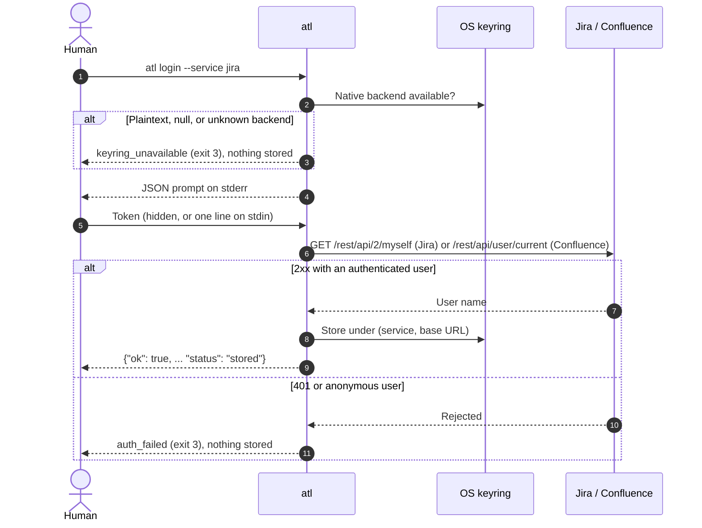

# Getting started

This page takes you from a fresh machine to a verified `atl` setup on Windows, macOS, or Linux.
You need Python 3.11 or later, network access to your Jira and Confluence Data Center servers,
and a native OS keyring. CI tests Python 3.11, 3.13, 3.14, and 3.15 on all three systems; 3.12
is not a CI matrix entry.

> [!IMPORTANT]
> A **human** runs `atl login`. The secret goes from a hidden prompt (or stdin) straight into the
> OS keyring. Never put a token or password in a command argument, a file, an environment
> variable an agent can read, or a chat with an AI tool.

## Install

`atl` is published on PyPI as `atlass-cli`. Install it with either one of these commands. Each
gives `atl` an isolated environment, links the command into a user `bin` folder, and works the
same on Windows, macOS, and Linux:

```bash
pipx install atlass-cli
# or
uv tool install atlass-cli
```

[`pipx`](https://pipx.pypa.io/) and [`uv`](https://docs.astral.sh/uv/) must already be installed
to use them. If `atl` is not found afterwards, that folder is not on your `PATH` yet: run
`pipx ensurepath` or `uv tool update-shell`, then open a new terminal and run `atl commands`.

Without `pipx` or `uv`, install into a virtual environment with `pip`. You need only Python 3.11
or later:

<!-- os-tabs:start -->

### Windows

Install Python 3.11+ from python.org or the Microsoft Store, then in PowerShell:

```powershell
py -3 --version                     # must be 3.11 or later
py -3 -m venv "$env:LOCALAPPDATA\atl\venv"
& "$env:LOCALAPPDATA\atl\venv\Scripts\python.exe" -m pip install atlass-cli
& "$env:LOCALAPPDATA\atl\venv\Scripts\atl.exe" commands
```

`py -3` runs the newest Python 3 you have installed. If it is older than 3.11, name a newer one
instead, for example `py -3.13`. If you have no `py` launcher (common with the Microsoft Store
build), use `python` in its place.

To run `atl` by name, append the environment's `Scripts` folder to your user `PATH`, then open a
new terminal:

```powershell
$scripts = "$env:LOCALAPPDATA\atl\venv\Scripts"
$userPath = [Environment]::GetEnvironmentVariable("Path", "User")
[Environment]::SetEnvironmentVariable("Path", "$userPath;$scripts", "User")
```

### macOS

Install Python 3.11+ (for example `brew install python@3.13`, pyenv, or python.org), then:

```bash
python3 --version                   # must be 3.11 or later
python3 -m venv ~/.local/share/atl/venv
~/.local/share/atl/venv/bin/python -m pip install atlass-cli
~/.local/share/atl/venv/bin/atl commands
```

If `python3 --version` is older than 3.11, use the newer interpreter by name, for example
`python3.13 -m venv ...`.

To run `atl` by name, append the environment's `bin` folder to `PATH` in `~/.zshrc` (the default
shell), then open a new terminal:

```bash
echo 'export PATH="$PATH:$HOME/.local/share/atl/venv/bin"' >> ~/.zshrc
```

### Linux

Install Python 3.11+ from your distribution or pyenv, then:

```bash
python3 --version                   # must be 3.11 or later
python3 -m venv ~/.local/share/atl/venv
~/.local/share/atl/venv/bin/python -m pip install atlass-cli
~/.local/share/atl/venv/bin/atl commands
```

If `python3 --version` is older than 3.11, use the newer interpreter by name, for example
`python3.11 -m venv ...`. On Debian and Ubuntu, if `venv` reports that `ensurepip` is not
available, install the matching package first (for example `sudo apt install python3.11-venv`).

To run `atl` by name, append the environment's `bin` folder to `PATH` in your shell profile
(`~/.bashrc` for bash), then open a new terminal:

```bash
echo 'export PATH="$PATH:$HOME/.local/share/atl/venv/bin"' >> ~/.bashrc
```

<!-- os-tabs:end -->

The `PATH` entry goes last, so the environment's own `python` never shadows the one you already
use.

`atl commands` works offline with no config. It prints one JSON object that lists every command.
If you see `{"ok": true, ...}`, the install works.

### From source (contributors)

To run unreleased changes, install from a checkout instead of PyPI. Clone the repository and
replace `atlass-cli` with `.` in any of the commands above, for example:

```bash
git clone https://github.com/calvinware/atlass-cli.git
cd atlass-cli
pipx install .
```

For an editable development environment with the test and docs tools, see
[Contributing](contributing.md#development-setup).

## Keyring prerequisites

`atl` stores credentials only in a native OS keyring. It refuses plaintext, null, and unknown
keyring backends, and it never falls back to a file. If no native keyring is usable, every
command that needs a credential fails with
[`keyring_unavailable`](reference/errors.md#keyring_unavailable) (exit 3).

<!-- os-tabs:start -->

### Windows

**Windows Credential Manager** is built in. Nothing to install. Entries are stored per Windows
user under the service name `atlass-cli`. You can see them in *Control Panel > Credential Manager >
Windows Credentials*.

### macOS

**macOS Keychain** is built in. The login keychain must be unlocked, which it is in a normal
desktop session. The first time `atl` reads its entry, macOS may ask whether Python may use the
keychain item; choose *Always Allow* for the interpreter that runs `atl`.

Over SSH the login keychain is usually locked. Unlock it first, or run `atl` from a desktop
session.

### Linux

`atl` uses the **Secret Service** API, provided by GNOME Keyring or KWallet, over a D-Bus session.
Desktop sessions normally have one running and unlocked.

- Headless servers, containers, and CI runners usually have no Secret Service. `atl` reports
  `keyring_unavailable` there by design.
- Over SSH, you need a D-Bus session and an unlocked keyring daemon. Running `atl` from your
  desktop session is simpler.
- Do not install `keyrings.alt` or configure a plaintext backend to work around this. `atl`
  refuses them.

<!-- os-tabs:end -->

## Configure `atl.yaml`

Your team keeps one `atl.yaml` in the repository root. If it exists, you are done with this step.
Otherwise an admin creates it from
[`atl.example.yaml`](../atl.example.yaml) using the [cookbook](admin-cookbook.md).

`atl` finds `atl.yaml` by walking up from the current directory. `--config PATH` overrides that.
The file never contains credentials.

## Log in (human only)

```bash
atl login --service jira          # hidden prompt for a personal access token
atl login --service confluence
```

The login flow verifies the credential before anything is stored:



Options:

- `--auth pat` (default) sends `Authorization: Bearer`. Use a Data Center personal access token.
- `--auth basic --username NAME` uses HTTP Basic with a password. Prefer PATs, especially when
  SSO fronts the server.
- `--token-stdin` / `--password-stdin` read one secret line per service from stdin, for a human
  piping from a password manager. Without a TTY, one of these flags is required.
- `--service all` logs in to Jira, then Confluence. A failure for either is
  [`login_failed`](reference/errors.md#login_failed) with per-service results.

The keyring entry is keyed by service and normalized base URL, so changing `base_url` needs a
new login.

## Verify the config against live Jira

```bash
atl config check --issue EXAMPLE-123
```

This is read-only. `pass` everywhere means `atl.yaml` matches live Jira. `drift` or `unverified`
checks each carry a `fix`; see [Troubleshooting](troubleshooting.md).

## Use it

```bash
atl jira feature find --text "single sign-on"
atl jira requirements EXAMPLE-42 --to "In Progress"
atl jira search --jql 'project = EXAMPLE AND status = "In Progress"' --limit 20
```

Next:

- [Jira workflows](guides/jira-workflows.md): stories, features, transitions, attachments
- [Confluence pages](guides/confluence.md): read, search, create, update
- [Agent guide](agents.md): let an AI coding tool drive `atl` safely
- [Command reference](reference/commands.md): every command, schema, and example
