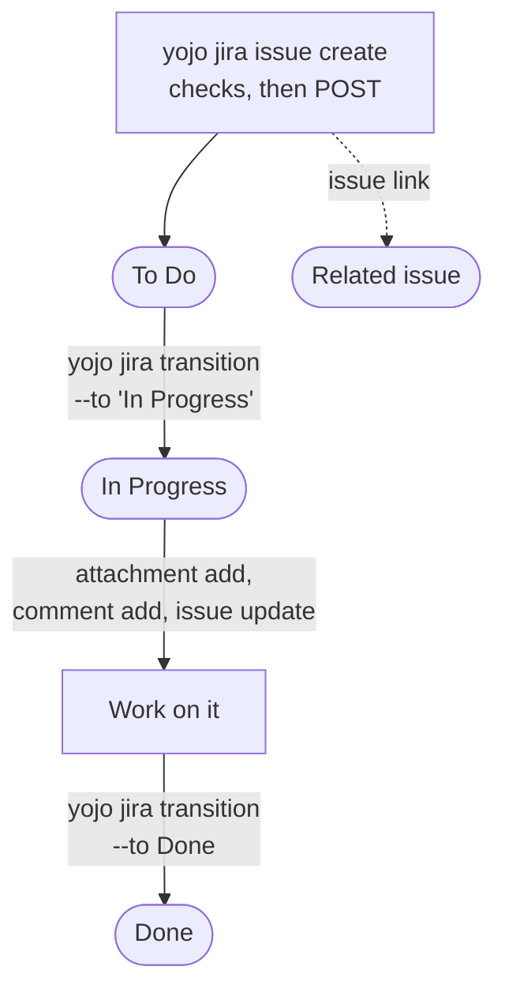
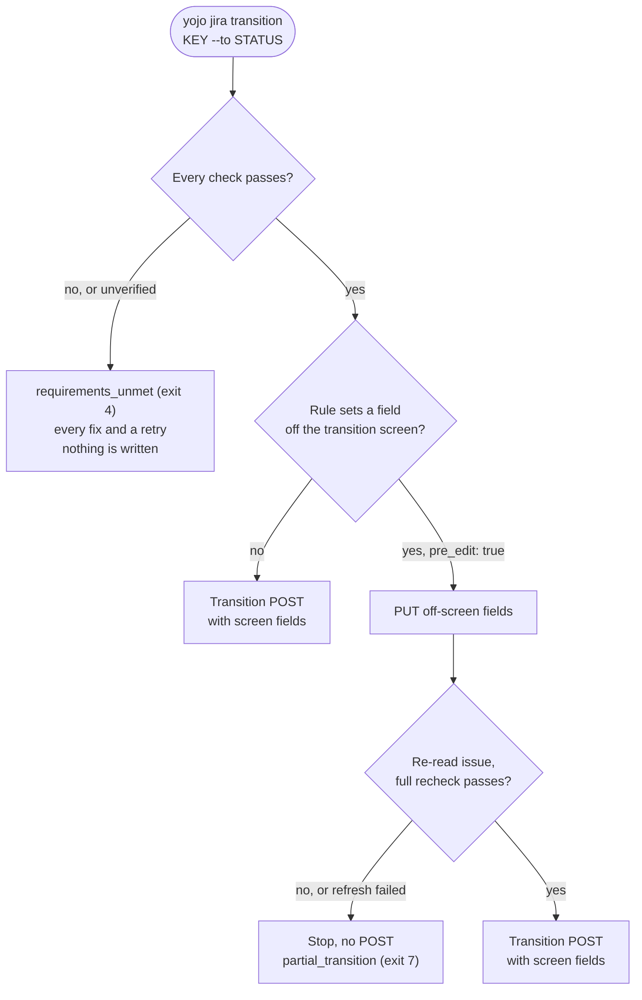
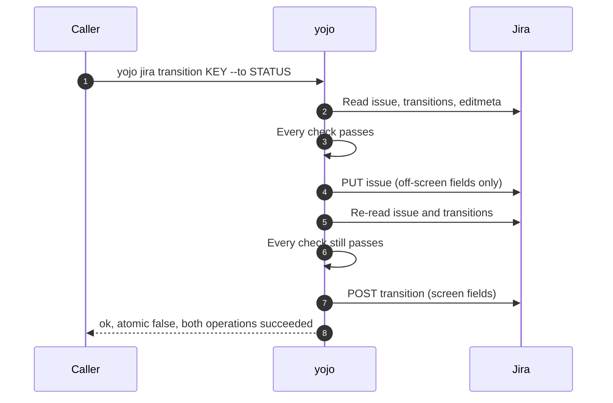

# Jira workflows

These task guides follow one issue from creation to Done. Each step is one command. In a terminal
you see a short summary and a link; scripts and agents pass `--json` and get one JSON object. On
failure, follow `error.fix`. Full contracts and examples are in the
[command reference](../reference/commands.md).

The examples pass no `--base-url`, so they assume a `yojo.yaml` with `jira.base_url`. Without one,
add `--base-url https://jira.example.test/jira` to each command.

## The lifecycle at a glance



The status names and the attachment rule in this guide come from
[`yojo.example.yaml`](../../yojo.example.yaml). Your Jira and your team's file define their own.

## Create an issue

```bash
yojo jira issue create PROJ --type Bug --summary "Login fails on Safari" \
  --set Severity=Major --set "Environment=Safari 18 on macOS" --set priority=High
```

In a terminal, `yojo` prints `Sending: ...` to stderr just before the request, then the new key and
a link to open it. Fields are named as Jira shows them, in any case. Values are the labels you see: an option, a
priority, a person's username or display name, a number, or a comma-separated list. Long
descriptions can come from a file:

```bash
yojo jira issue create --input - <<'JSON'
{"project": "PROJ", "type": "Story", "summary": "Export the audit log as CSV",
 "description": "Admins need a CSV export of the audit log.\n\nOut of scope: PDF.",
 "fields": {"Story Points": 3, "Labels": ["audit", "export"]}}
JSON
```

Before anything is sent, `yojo` reads the live create screen for that project and type and checks
every field you gave, every field Jira requires, and every field your `yojo.yaml` requires under
`create.<Type>.required`. All problems come back at once as
[`requirements_unmet`](../reference/errors.md#requirements_unmet) (exit 4), with nothing sent. If
the issue type in that project also required Severity and Environment, a call without them would
show:

```text
Error: Creating a Bug in PROJ was refused with 2 problem(s); nothing was sent.

Status  Id                          Message
fail    required:customfield_10500  Jira requires Severity (customfield_10500) to create a Bu...
fail    required:customfield_10600  Jira requires Environment (customfield_10600) to create a...

To fix
- Add --set 'Severity=<value>'. Allowed values: 'Critical', 'Major', 'Minor'.
- Add --set 'Environment=<value>'.

Next: Apply each check's fix, then run details.retry (placeholders in <angle brackets> need your content).
Retry: yojo jira issue create PROJ --type Bug --summary 'Login fails on Safari' --set 'Severity=<value>' --set 'Environment=<value>'
```

`details.retry` (shown as `Retry:` in a terminal) is your command with every fix applied.
Replace each `<value>` with real content and run it once.

> [!TIP]
> Teams name fields their own way. A `yojo.yaml` alias such as `points: {jira_name: Story Points}`
> lets everyone write `--set points=3`. See [Configuration](../configuration.md#fields-and-aliases).

## Read, update, and link

```bash
yojo jira issue get PROJ-123 --fields "Story Points,description"
yojo jira issue update PROJ-123 --set "Story Points=5" --set assignee=builder1
yojo jira issue link PROJ-124 PROJ-123 --type blocks
```

- `issue get` returns the essentials plus the fields you name. Long text is cut at 2000 characters
  and marked `truncated`; the `more` command returns it in full.
- `issue update` checks every field against the issue's edit screen first. After Jira accepts the
  change, `yojo` reads the fields back. If Jira reports different values (for example, an automation
  changed them), the result is [`outcome_unknown`](../reference/errors.md#outcome_unknown), not
  success.
- `issue link` takes the link type's name (`Blocks`) or either direction's wording (`blocks`,
  `is blocked by`). `PROJ-124 blocks PROJ-123` reads left to right. The link is read back from the
  issue before success is reported.

## Move to In Progress

```bash
yojo jira transition PROJ-123 --to "In Progress"
```

`--to` takes the destination status or the transition's name, in any case. `transition` checks
everything first and then writes, in the same call. To look without writing, run the same checks
on their own:

```bash
yojo jira requirements PROJ-123 --to "In Progress"
```

The answer has `ready`, every check with its `fix`, and `plan.operations`, the exact writes a
transition would send.

On a narrow screen, scroll the next two diagrams sideways to read their labels.

<div role="region" aria-label="Transition decision diagram" tabindex="0" style="overflow-x: auto;">
<div markdown="1" style="min-width: 720px;">



</div>
</div>

The checks cover:

- **Jira's own rules:** exactly one transition to that status is offered now; every field you pass
  with `--set` is on the transition screen and its value is valid; every field the screen requires
  is supplied.
- **Your team's rules** in `yojo.yaml`, when the project has a rule for this destination: the
  issue's current status is in the rule's `from`; each `auto_set` value is valid and placed; each
  `require` entry passes (an attachment name pattern, or a field that must have a value).

Pass screen values on the command line, for example
`yojo jira transition PROJ-123 --to Done --set resolution=Fixed`. A field that is not on the
transition screen is refused with a fix to set it first with `yojo jira issue update`.

If the project is configured and the issue moved to another key or project, the command stops with
[`issue_key_mismatch`](../reference/errors.md#issue_key_mismatch) (exit 2). The checks cannot see
workflow validators that Jira does not expose over REST; if one rejects the transition, the result
is [`remote_validation`](../reference/errors.md#remote_validation) (exit 5) and nothing changed.

### When the plan has an edit (`pre_edit`)

If a team rule's `auto_set` targets a field that is not on the transition screen and the team opted
in with `pre_edit: true`, the plan has an `edit` (PUT) before the `transition` (POST) and
`"atomic": false`. These are two separate writes. When everything succeeds:

<div role="region" aria-label="Pre-edit sequence diagram" tabindex="0" style="overflow-x: auto;">
<div markdown="1" style="min-width: 720px;">



</div>
</div>

Any other outcome stops at the step that failed:

| Situation | Result | POST |
|-----------|--------|------|
| PUT rejected | original error, usually `remote_validation` (exit 5) | not attempted |
| PUT outcome unknown | `outcome_unknown` (exit 6), edit `unknown` | not attempted |
| PUT succeeded, refresh fails or a check no longer passes | `partial_transition` (exit 7) | skipped |
| PUT succeeded, POST rejected | `partial_transition` (exit 7) | rejected |
| PUT succeeded, POST outcome unknown | `outcome_unknown` (exit 6), edit `succeeded` | unknown |
| both succeed | success, `atomic: false` | succeeded |

> [!WARNING]
> `yojo` never rolls back the edit and never retries. Running the transition again sends the PUT
> again, which can overwrite a change made since. After exit 6 or 7: inspect the issue's status and
> edited fields, reconcile with the issue owner, and run it again only after `requirements` says
> `ready: true`. See [`pre_edit` (non-atomic)](../configuration.md#pre_edit-non-atomic) and
> [Writes and retries](../commands.md#writes-and-retries).

## Attach a supporting file and move to Done

The example config requires an attachment named `{key}_Evidence_*` before Done:

```bash
yojo jira attachment add PROJ-123 --file PROJ-123_Evidence_2026-10-24.xml
yojo jira transition PROJ-123 --to Done --set resolution=Fixed
```

Before upload, `yojo` checks that the file exists, is a regular file, and is within
`jira.max_attachment_bytes`; that the issue exists; that you may attach files; and that Jira
accepts a file of that size. It then uploads a private snapshot of the opened file. A file that is
replaced or changes while `yojo` reads it is rejected before anything is sent (see
[Attachments](../commands.md#attachments)). The upload succeeds only when Jira's response confirms
the file name and size. If the Done rule's attachment requirement fails, the check lists the
attachment names on the issue and the exact pattern it needs.

## Comment

```bash
yojo jira comment add PROJ-123 --body "Fixed in build 42."
yojo jira comment add PROJ-123 --body-file - <<'EOF'
Supporting file attached: PROJ-123_Evidence_2026-10-24.xml.
EOF
```

The body is plain UTF-8 text, at most 1 MiB, and must not be empty. The result links straight to
the new comment.

## Search

```bash
yojo jira search --jql 'project = PROJ AND status = "In Progress"'
yojo jira search --jql 'project = PROJ ORDER BY updated DESC' --start 20
```

Results have `key`, `summary`, `status`, `issue_type`, and `assignee`, plus `total` and
`next_start` (`null` on the last page). The default `--limit` is 20, at most 100. Search does
**not** return comments, attachments, or custom field values; use `yojo jira issue get KEY
--fields ...` for those.

## When a write's outcome is unknown

A timeout, disconnect, 408, 499, 5xx, redirect, or unconfirmed success response on a write is
[`outcome_unknown`](../reference/errors.md#outcome_unknown) (exit 6). The write may or may not have
happened, so there is no retry line. Inspect before you do anything else:

| Uncertain write | How to inspect |
|-----------------|----------------|
| issue create | The `yojo jira search` in `error.fix` (recent issues in the project), then confirm each candidate with `yojo jira issue get` |
| issue update | `yojo jira issue get KEY --fields '<fields you set>'` |
| issue link | `yojo jira issue get KEY --fields issuelinks` on the source issue |
| comment | Ask a human to look for the exact comment in the issue view |
| attachment | Ask a human to look for the exact file name and size in the issue view |
| transition | `yojo jira issue get KEY` for the status, then `yojo jira requirements KEY --to STATUS` |

Run the write again only when inspection shows it was **not** applied. If you cannot tell, or you
find duplicates, stop and ask a human. The full rules are in
[Writes and retries](../commands.md#writes-and-retries).
