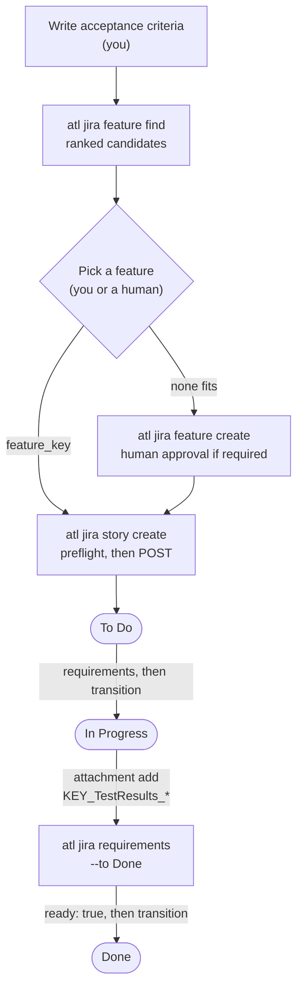
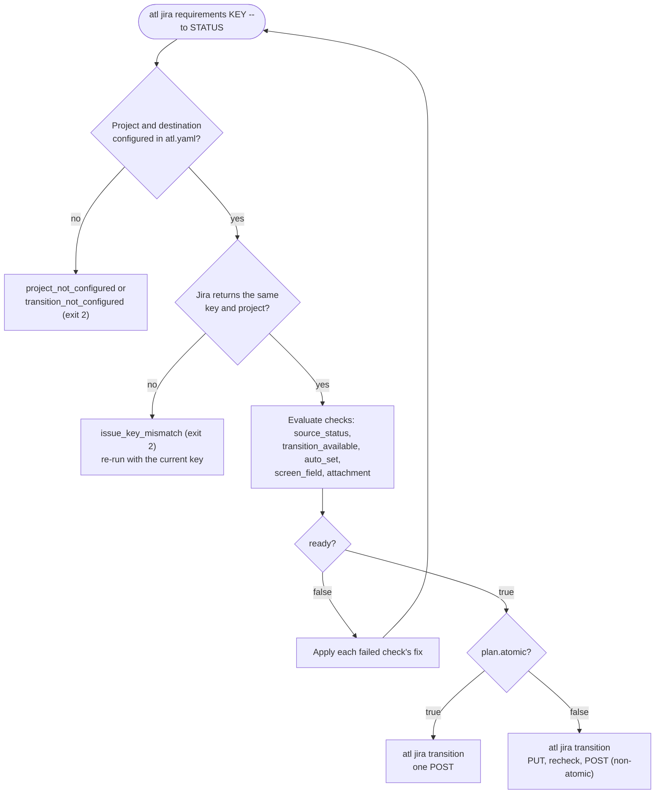
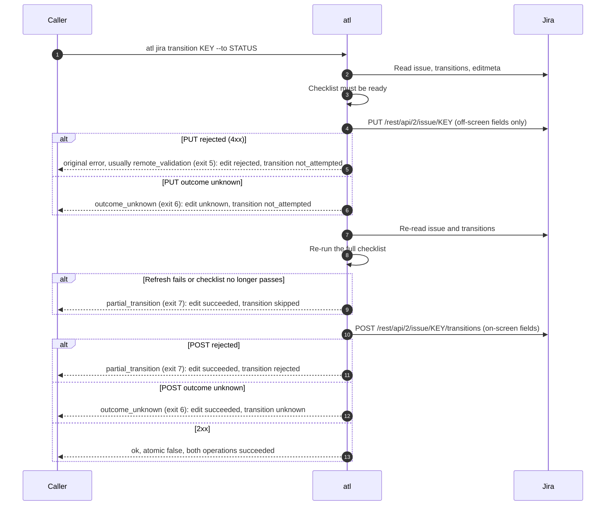

# Jira workflows

These task guides follow one story from creation to Done. Every command prints one JSON object;
check `ok`, and on failure follow `error.fix`. Full contracts and examples are in the
[command reference](../reference/commands.md).

## The lifecycle at a glance



The status names and the attachment rule above come from the example `atl.yaml`. Your team's
file defines its own.

## Create a story with acceptance criteria and a feature link

Two judgment calls stay with you: the **acceptance criteria** text and the **parent feature**.
`atl` never writes the first and never picks the second.

1. Find candidate features:

    ```bash
    atl jira feature find --text "single sign-on login"
    ```

    Candidates are ranked deterministically: +100 when the key appears in `--text`, +10 per
    shared summary word, +5 for the same project as `--issue`. Each has `reasons`, and the result
    always says `"selection": "caller"`. Use `--issue EXAMPLE-41` instead of `--text` to rank
    against an existing issue's summary.

2. Choose one. If none fits, ask a human or [create a feature](#find-or-create-a-feature).

3. Create the story:

    ```bash
    atl jira story create --input - <<'JSON'
    {"project": "EXAMPLE",
     "summary": "Add a single sign-on button to the login page",
     "acceptance_criteria": "Given a signed-out user\nWhen they choose Sign in with SSO\nThen they are signed in",
     "feature_key": "EXAMPLE-10"}
    JSON
    ```

Before sending anything, `atl` runs the create preflight: acceptance criteria present, the feature
exists and is the configured feature type in a configured project, every field in
`create.story.required` is on the live create screen with a value, every supplied field
serializes under its encoding, and every live required field is supplied. Any failure is
[`requirements_unmet`](../reference/errors.md#requirements_unmet) (exit 4) with every check, and
nothing is sent.

> [!TIP]
> Extra team fields go in `fields`, keyed by the friendly names in `atl.yaml`, for example
> `"fields": {"team": "Platform"}`. `acceptance_criteria` and `feature_key` always go at the top
> level.

## Find or create a feature

```bash
atl jira feature find --text "audit log export"
```

If no candidate fits, creating a feature depends on the project's `feature_create_policy`:

- `automatic`: send the input; preflight still runs against `create.feature.required`.
- `human_confirmed` (the default): a human must approve first. Without `human_confirmation`, the
  result is [`approval_required`](../reference/errors.md#approval_required) (exit 4) and nothing
  is sent.

```bash
atl jira feature create --input - <<'JSON'
{"project": "EXAMPLE",
 "summary": "Audit log export",
 "human_confirmation": {
   "confirmed_by": "Jordan Lee",
   "statement": "Approved creating the audit log export feature in planning on 2026-10-24."}}
JSON
```

> [!WARNING]
> The attestation is recorded text. `atl` cannot verify who approved, and the result says
> `"identity_verified": false`. An agent must never invent a name or an approval.

## Move to In Progress

Always ask for the checklist first. It is read-only:

```bash
atl jira requirements EXAMPLE-42 --to "In Progress"
```

The answer has `ready`, every check with its `fix`, and `plan.operations`, the exact writes a
transition would send. Then:

```bash
atl jira transition EXAMPLE-42 --to "In Progress"
```

`transition` re-runs the same checklist and refuses with
[`requirements_unmet`](../reference/errors.md#requirements_unmet) (exit 4) if it is not ready.



Values set during a transition come only from `auto_set` in `atl.yaml`. The checklist cannot see
workflow validators that Jira does not expose over REST; if one rejects the transition, the result
is [`remote_validation`](../reference/errors.md#remote_validation) (exit 5).

### When the plan has an edit (`pre_edit`)

If `auto_set` targets a field that is not on the transition screen and the team opted in with
`pre_edit: true`, the plan has an `edit` (PUT) before the `transition` (POST) and
`"atomic": false`. These are two separate writes:



> [!WARNING]
> `atl` never rolls back the edit and never retries. A retry sends the PUT again, which can
> overwrite a change made since. After exit 6 or 7: inspect the issue's status and edited fields,
> reconcile with the issue owner, and retry only after a fresh `requirements` says
> `ready: true`. See [`pre_edit` (non-atomic)](../configuration.md#pre_edit-non-atomic).

## Attach test results and move to Done

The example config requires an attachment named `{key}_TestResults_*` before Done:

```bash
atl jira attachment add EXAMPLE-42 --file EXAMPLE-42_TestResults_2026-10-24.xml
atl jira requirements EXAMPLE-42 --to Done
atl jira transition EXAMPLE-42 --to Done
```

Before upload, `atl` checks that the file exists, is a regular file, and is within
`jira.max_attachment_bytes`. The upload succeeds only when Jira's response confirms the file name
and size. If the requirement fails, the check lists the attachment names on the issue and the
exact pattern it needs.

## Comment

```bash
atl jira comment add EXAMPLE-42 --body-file - <<'EOF'
Test results attached: EXAMPLE-42_TestResults_2026-10-24.xml (128 passed, 0 failed).
EOF
```

The body is plain UTF-8 text, at most 1 MiB, and must not be empty.

## Search

```bash
atl jira search --jql 'project = EXAMPLE AND status = "In Progress"' --limit 20
atl jira search --jql 'project = EXAMPLE ORDER BY updated DESC' --start 20 --limit 20
```

Results have `key`, `summary`, `status`, `issue_type`, `project`, `assignee`, and `updated`, plus
`total` and `next_start` (`null` on the last page). `--limit` is at most 100. Search does **not**
return comments, attachments, or custom field values.

## When a write's outcome is unknown

A timeout, disconnect, 408, 499, 5xx, redirect, or unconfirmed success response on a write is
[`outcome_unknown`](../reference/errors.md#outcome_unknown) (exit 6). The write may or may not have
happened. Inspect before you do anything else:

| Uncertain write | How to inspect |
|-----------------|----------------|
| story or feature create | `atl jira search` for the summary and a narrow `created >=` window, then confirm each candidate in the Jira issue view |
| comment | Ask a human to look for the exact comment in the issue view |
| attachment | Ask a human to look for the exact file name and size in the issue view |
| transition | `atl jira requirements KEY --to STATUS` (`from_status`) or `atl jira search --jql 'key = KEY'` |

Retry only when inspection shows the write was **not** applied. If you cannot tell, or you find
duplicates, stop and ask a human. The full rules are in
[Writes and retries](../commands.md#writes-and-retries).
