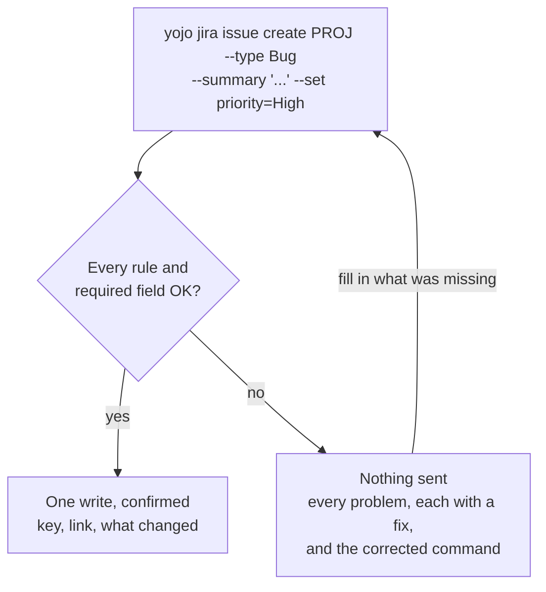

# yojo


`yojo` is a command line for Jira, Confluence, and Bitbucket Data Center, built so that a developer,
a Jira admin, or an AI agent on any model can do a task in **one call**. It speaks Jira's words
(field names, statuses, option labels, people), resolves the IDs itself, checks every rule before it
writes, and reports every problem at once with the corrected command. It works with no config; a
`yojo.yaml` adds your team's friendly names and rules on top.

## Pick your path

| You are | Start here | Then |
|---------|-----------|------|
| **Developer** using `yojo` daily | [Getting started](getting-started.md) | [Jira workflows](guides/jira-workflows.md), [Confluence pages](guides/confluence.md) |
| **AI agent** (or building one) | [Agent guide](agents.md) | [Command reference](reference/commands.md), [Error catalog](reference/errors.md) |
| **Team admin** owning `yojo.yaml` | [Cookbook](admin-cookbook.md) | [Configuration reference](configuration.md), [Troubleshooting](troubleshooting.md) |
| **Contributor** changing `yojo` | [Contributing](contributing.md) | [Security](security.md), [Command behavior](commands.md) |

## One call per task



Creates, updates, links, transitions, comments, and attachments all work this way. A write is
reported as done only when the server confirms it; otherwise the result says how to inspect what
happened, and `yojo` never retries on its own.

## What you get

- **Two faces, one contract.** In a terminal: aligned tables, plain-language status, and a link
  after every write. Piped or with `--json`: exactly one compact JSON object, with fixed
  [exit codes](reference/errors.md#exit-codes) in both modes.
- **Natural values.** `--set "Story Points=3" --set priority=High --set assignee=builder1`. Any
  letter case; near misses get "Did you mean ...?".
- **All problems at once.** A refused write lists every problem with a concrete `fix` and a
  `retry` line, and nothing is sent.
- **Works without config.** `--base-url` and a keyring login are enough. `yojo.yaml` adds aliases,
  fields required on create, and transition rules.
- **Offline discovery.** `yojo commands` and `yojo schema '<command>'` need no config or
  credentials.
- **Secrets in the OS keyring** only, with verified TLS and no redirects.

> [!NOTE]
> The automated tests model documented Data Center responses. They do not prove live
> compatibility; see the compatibility section in the repository README.

## Quick taste

```bash
yojo commands                                         # offline
yojo schema 'jira issue create'                       # offline
yojo jira issue get PROJ-123 --base-url https://jira.example.test/jira
yojo jira transition PROJ-123 --to Done --set resolution=Fixed
```
