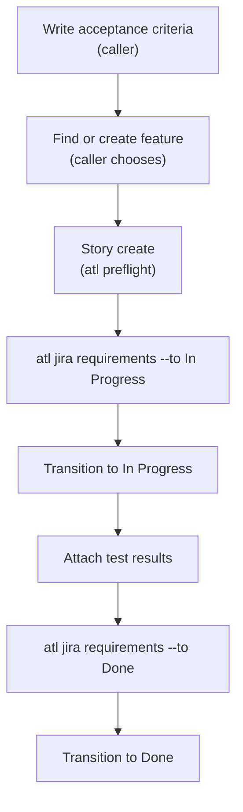

# atl


`atl` gives AI coding agents and developers one JSON interface to Jira and Confluence Data
Center. Your team's fixed rules live in `atl.yaml`: field IDs, required fields, what each
workflow step needs, and required attachments. Judgment calls, such as writing acceptance
criteria and choosing a parent feature, stay with the caller.

## Pick your path

| You are | Start here | Then |
|---------|-----------|------|
| **Developer** using `atl` daily | [Getting started](getting-started.md) | [Jira workflows](guides/jira-workflows.md), [Confluence pages](guides/confluence.md) |
| **AI agent** (or building one) | [Agent guide](agents.md) | [Command reference](reference/commands.md), [Error catalog](reference/errors.md) |
| **Team admin** owning `atl.yaml` | [Cookbook](admin-cookbook.md) | [Configuration reference](configuration.md), [Troubleshooting](troubleshooting.md) |
| **Contributor** changing `atl` | [Contributing](contributing.md) | [Security](security.md), [Command behavior](commands.md) |

## Story lifecycle



Feature creation runs its own preflight, and a human confirms it first when the project's policy
requires it. Transition only after `atl jira requirements` reports `ready: true`. The status names
and the test-results attachment rule are example values from `atl.example.yaml`; your team's
`atl.yaml` defines its own.

## What you get

- **One JSON object per call**, with fixed [exit codes](reference/errors.md#exit-codes) and a
  concrete `fix` for every error.
- **Offline discovery**: `atl commands` and `atl schema '<command>'` need no config or
  credentials.
- **Checklists before writes**: create preflight and `atl jira requirements` gate every story,
  feature, and transition.
- **Honest write outcomes**: success only when the server confirms it; `outcome_unknown` and
  `partial_transition` otherwise, and never an automatic retry.
- **Secrets in the OS keyring** only, with verified TLS and no redirects.

> [!NOTE]
> The automated tests model documented Data Center responses. They do not prove live
> compatibility; see the compatibility checklist in the repository README.

## Quick taste

```bash
atl commands                                   # offline
atl schema 'jira story create'                 # offline
atl jira feature find --text "single sign-on"
atl jira requirements EXAMPLE-42 --to "In Progress"
```
