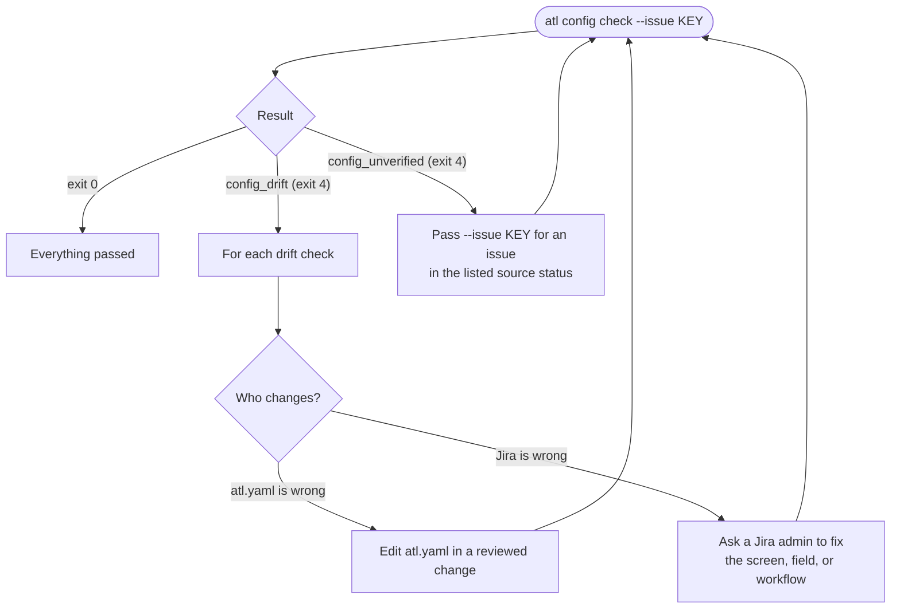

# Troubleshooting

Start with the output. Every failure has `error.code`, a `message`, and a `fix` written for that
exact call. The [error catalog](reference/errors.md) explains each code.

## Setup and login

| Symptom | Code | Fix |
|---------|------|-----|
| `No atl.yaml found` | `config_not_found` | Run from inside the repository, or pass `--config PATH`. |
| A config key is rejected | `config_invalid` | Fix the key in `details.where`; unknown keys, anchors, and custom tags are refused. |
| No credential stored | `auth_missing` | A human runs `atl login --service jira` (or `confluence`). |
| 401 from the server | `auth_failed` | The token expired or was revoked. A human runs `atl login` again. |
| No secure keyring | `keyring_unavailable` | Use the native keyring for your OS; see [keyring prerequisites](getting-started.md#keyring-prerequisites). |
| `redirect_refused` | `redirect_refused` | Set `base_url` to the final HTTPS URL with its context path. SSO redirects usually mean you need a PAT. |
| TLS verification failed | `tls_error` | Check the host name. For an internal CA, set `ca_bundle` to its PEM file. Verification is never disabled. |
| Every call returns `not_found` or `response_invalid` | `not_found`, `response_invalid` | `base_url` is probably missing the context path (`/jira`, `/confluence`). |

## Config drift

`atl config check [--issue KEY]` is read-only. Each check ID names what it covers:

| Check ID pattern | What it compares |
|------------------|------------------|
| `PROJ:issue_type:TYPE` | Each `allowed_issue_types` entry is creatable in the project. |
| `PROJ:Story:field:NAME`, `PROJ:Feature:field:NAME` | A mapped field resolves to exactly one field on that create screen, allows `set`, and matches its encoding. |
| `PROJ:Story:create_field:FIELD` | A live required create field that `atl.yaml` does not map. |
| `PROJ:transition:NAME:SOURCE[:check]` | The transition from `SOURCE`, probed on a sample issue in that status. |

Common drift and its fix:

- **Field not on the create screen.** Ask a Jira admin to add it, or correct `fields.NAME` in
  `atl.yaml`. A field listed in `create.*.required` is never skipped.
- **Ambiguous `jira_name`.** Two fields share the display name. Replace `jira_name` with the `id`
  from the check's details.
- **Encoding incompatible.** The live field schema does not match the encoding (for example a
  select field mapped as `text`). Change the encoding; see the
  [encoding table](configuration.md#fields-and-encodings).
- **Description required.** `PROJ:Story:create_field:description` means Jira requires Description
  on that create screen. Every create of that type must then include the top-level
  `description`, or a Jira admin makes it optional.
- **Transition screen needs a field.** A required field on the transition screen must be covered
  by `auto_set`.
- **`auto_set` field not on the screen.** Add it to the transition screen, or opt in with
  `pre_edit: true` after reading about the [non-atomic risk](configuration.md#pre_edit-non-atomic).

`unverified` never counts as `pass`. It usually means no issue was in a transition's source
status. Re-run with `--issue KEY` for an issue in that status. `--issue` is used only for sources
it matches; others fall back to search.

## Workflow failures

| Symptom | Code | Fix |
|---------|------|-----|
| Story create refused | `requirements_unmet` | Read `details.checks`; write the acceptance criteria and choose the feature yourself. |
| Feature create refused | `approval_required` | Ask a human to approve, then pass `human_confirmation`. |
| Transition refused | `requirements_unmet` | Run `atl jira requirements` and apply each failed check's fix. |
| `--to` not accepted | `transition_not_configured` | Use a destination from `details.configured`. |
| Issue moved | `issue_key_mismatch` | Re-run with `details.current_key`. |
| Jira rejected a transition after preflight passed | `remote_validation` | A workflow validator that REST does not expose; check with a Jira admin. |
| Attachment refused before upload | `attachment_too_large`, `file_invalid` | Check the path and size against `jira.max_attachment_bytes`. |
| Attachment refused by the server | `remote_limit_exceeded` | The server or proxy limit is lower than `atl`'s. |
| Confluence update refused | `version_conflict` | Re-read the page, merge, and resubmit with the new version. |

## Unknown and partial writes

> [!IMPORTANT]
> `outcome_unknown` (exit 6) and `partial_transition` (exit 7) mean something may already have
> changed. Do not retry blindly. Inspect first, using
> [Writes and retries](commands.md#writes-and-retries).

## Still stuck

- `atl schema '<command>'` shows the exact contract for a command.
- `details` in the error output carries the specifics: field names, check IDs, server messages.
  Server messages are sanitized and bounded, and credentials are redacted.
- For unexpected `internal_error`, report `details.error_type` to the maintainers.
