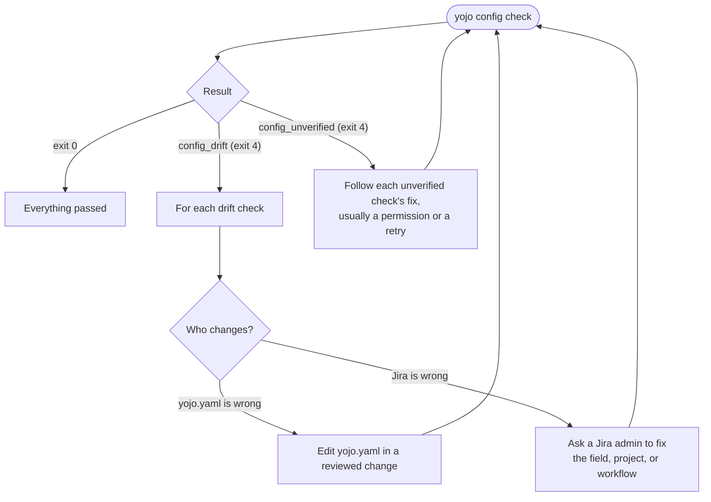

# Troubleshooting

Start with the output. Every failure has `error.code`, a `message`, and a `fix` written for that
exact call. The [error catalog](reference/errors.md) explains each code.

## Setup and login

| Symptom | Code | Fix |
|---------|------|-----|
| `No jira URL is set` | `service_not_configured` | Pass `--base-url https://jira.example.test/jira` (your instance root with its context path), or add `jira.base_url` to `yojo.yaml`. |
| `Found .../atl.yaml from atl, but no yojo.yaml` | `config_legacy` | Rename it to `yojo.yaml` and review it; see [Moving from `atl.yaml`](configuration.md#moving-from-atlyaml). Nothing was changed. |
| `--base-url` differs from the config | `input_invalid` | Drop `--base-url`, or pass `--config` with a `yojo.yaml` for that instance. |
| `Config file not found` | `config_not_found` | The `--config PATH` does not exist. `yojo config check` also needs a `yojo.yaml`. |
| A config key is rejected | `config_invalid` | Fix the key in `details.where`; unknown keys, anchors, and custom tags are refused. |
| No credential stored | `auth_missing` | A human runs `yojo login --service jira --base-url URL` (or `confluence`, or `bitbucket`). Logins made with `atl` are not reused. |
| 401 from the server | `auth_failed` | The token expired or was revoked. A human runs `yojo login` again. |
| No secure keyring | `keyring_unavailable` | Use the native keyring for your OS; see [keyring prerequisites](getting-started.md#keyring-prerequisites). |
| `redirect_refused` | `redirect_refused` | Set `base_url` to the final HTTPS URL with its context path. SSO redirects usually mean you need a PAT. |
| TLS verification failed | `tls_error` | Check the host name. For an internal CA, set `ca_bundle` to its PEM file. Verification is never disabled. |
| Every call returns `not_found` or `response_invalid` | `not_found`, `response_invalid` | The base URL is probably missing the context path (`/jira`, `/confluence`, `/bitbucket`). For Bitbucket, set `bitbucket.base_url: https://bitbucket.example.test/bitbucket`. |
| `yojo setup` says `Save did not finish` | any | Setup could not confirm what the file holds: it may have changed or could not be read. Open the file named in the message and check it, then press Refresh preview and review the diff before you press Save again. If you leave setup, its summary says the save was not confirmed. |
| `yojo setup` says a file was saved but a check after writing failed | any | The file holds exactly the preview you reviewed; a step after writing failed. Continue to the Try step, or run `yojo config check` to read the file back. |

## Config drift

`yojo config check` is read-only. Each check ID names what it covers:

| Check ID pattern | What it compares |
|------------------|------------------|
| `field:ALIAS` | A global alias in `jira.fields` resolves to exactly one Jira field. |
| `PROJ:project` | The project exists and is visible to you. |
| `PROJ:field:ALIAS` | A project alias resolves to exactly one Jira field. |
| `PROJ:transition:RULE:from:STATUS`, `PROJ:transition:RULE:to` | The rule's statuses exist in the project's workflows. |
| `PROJ:transition:RULE:field:NAME` | An `auto_set` or `field_set` field resolves to exactly one Jira field. |
| `PROJ:create:TYPE`, `PROJ:create:TYPE:field:NAME` | The issue type can be created in the project, and each required field resolves. |

Common drift and its fix:

- **Name not found.** The check suggests the closest name when there is one ("Did you mean
  'Story Points'?"). Fix the spelling in `yojo.yaml`, or ask a Jira admin whether the field,
  status, or issue type was renamed.
- **Ambiguous `jira_name`.** Two fields share the display name. Replace `jira_name` with the `id`
  from the check's details.
- **Status not in the project.** A rule's `from` or `to` names a status the project's workflows do
  not use. Update the rule.
- **Issue type cannot be created.** A `create` block names a type the project does not offer.

`unverified` never counts as `pass`. Screens (which fields are on a create, edit, or transition
screen) are not part of `config check`: every write checks them live and refuses with each
problem listed.

## Workflow failures

| Symptom | Code | Fix |
|---------|------|-----|
| A write was refused before sending | `requirements_unmet` | Read `details.checks`; apply each fix, fill each `<placeholder>` with real content, and run `details.retry` once when it is present. Nothing was sent. |
| `retry` is `null` | `requirements_unmet` | Either a value to fix came from `--input` (edit the input document, then run the same command), or the duplicate check found an open pull request or an identical comment that already exists. Follow each check's `fix` and use the existing item; never send the duplicate write again. |
| "Did you mean ...?" | `requirements_unmet`, `input_invalid` | Nothing was guessed. Run the corrected command if the suggestion is what you meant. |
| A name matches several fields | `requirements_unmet` | Use one of the listed IDs (for example `customfield_10700`) in place of the name. |
| Same field given twice | `input_invalid` | Give each field once, with `--set` or in the input, not both with different values. |
| Issue moved | `issue_key_mismatch` | Re-run with `details.current_key`. |
| Jira rejected a transition after preflight passed | `remote_validation` | A workflow validator that REST does not expose; check with a Jira admin. |
| Attachment refused before upload | `attachment_too_large`, `file_invalid` | Check the path and size against `jira.max_attachment_bytes`. |
| Attachment refused by the server | `remote_limit_exceeded` | The server or proxy limit is lower than `yojo`'s. |
| Confluence update refused | `version_conflict` | Re-read the page, merge, and resubmit with the new version. |

## Unknown and partial writes

> [!IMPORTANT]
> `outcome_unknown` (exit 6) and `partial_transition` (exit 7) mean something may already have
> changed, so no retry line is offered. Inspect first, using
> [Writes and retries](commands.md#writes-and-retries).

## Still stuck

- `yojo commands` shows every command's usage and an example; `yojo schema '<command>'` shows
  the exact contract.
- `details` in the error output carries the specifics: field names, check IDs, server messages.
  Server messages are sanitized and bounded, and credentials are redacted.
- For unexpected `internal_error`, report `details.error_type` to the maintainers.
